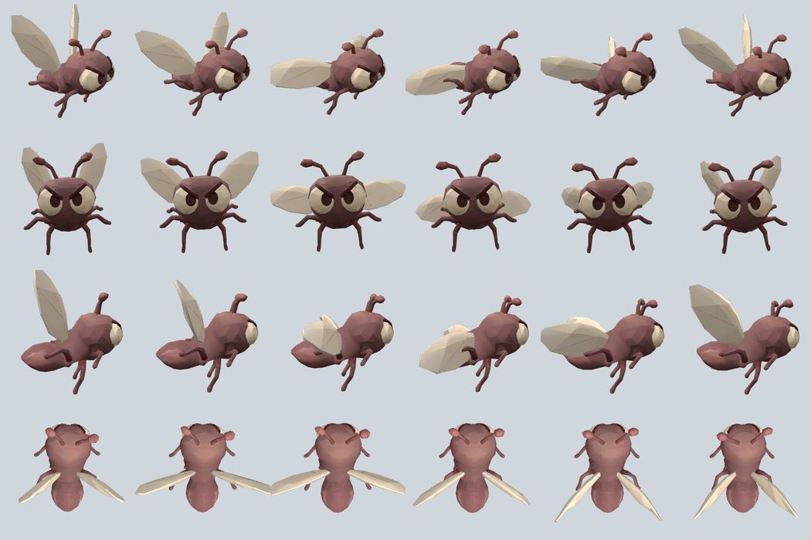
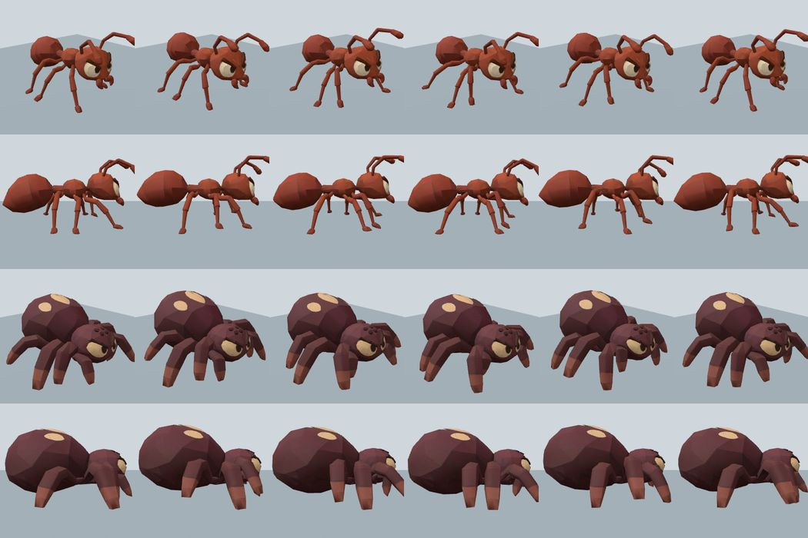

# Pipeline des assets Meshy — outillage Docker local et CI

Le jeu embarque des modules JS dérivés de GLB Meshy ; l'outillage ci-dessous est
un **outil de développement ponctuel**, sans serveur, port, GPU, coût Meshy ni
déploiement sur le VPS. Il n'est pas intégré au conteneur du jeu.

## Exécuter

Prérequis sur l'hôte : Docker et Docker Compose, **pas Node ni Python**.
L'image Docker utilise Node 22, glTF Transform (lecture/écriture GLB) et
meshoptimizer (simplification d'indices géométriques).

```sh
mkdir -p assets/originals assets/optimized
# Déposer un GLB APPROUVÉ dans assets/originals/modèle.glb
docker compose -f compose.assets.yaml build optimizer
docker compose -f compose.assets.yaml run --rm optimizer \
  inspect '/assets/originals/modèle.glb'
docker compose -f compose.assets.yaml run --rm optimizer \
  optimize '/assets/originals/modèle.glb' '/assets/optimized/modèle.glb'
docker compose -f compose.assets.yaml run --rm optimizer \
  validate '/assets/originals/modèle.glb' '/assets/optimized/modèle.glb'
```

Par défaut, les noms de parties tels que `turret`, `rotor`, `prop`, `wheel`
et `canon` sont **exclus de la simplification** ; on peut fournir un motif
`--protect 'rotor|tail|gun'`. Pour un GLB monobloc, l'outil exige des boîtes de protection explicites
(`--regions /assets/originals/zones.json`), sinon `--allow-monobloc` n'est
utilisable que pour une exploration sans validation des pièces mobiles.

Le profil prudent par défaut cible **75 % des triangles restants**
(`--ratio 0.75`, `--error 0.001`). Pour comparer d’autres variantes,
essayer `--ratio 0.5` ou `--ratio 0.25` sur des copies ; la réduction
réelle peut être moindre et n’est jamais garantie. `--error 0.001` limite la déformation géométrique
relative ; les bordures sont verrouillées. Pas de modification des coordonnées
UV, positions, normales, textures ou matériaux : seul le tableau des indices
des triangles peut changer. Il est possible qu'aucune simplification ne soit
réalisable dans ces contraintes. Les textures ne sont pas recompressées. Un fichier GLB peut **grossir**, même
avec moins de triangles (en-têtes et représentation des buffers) : le rapport
le signale et aucun gain de taille ou de FPS n'est garanti.

Sur Linux, si votre UID/GID hôte diffère de 1000, exécuter
`export ASSETS_UID=$(id -u) ASSETS_GID=$(id -g)` avant les commandes Compose.
Le conteneur conserve un utilisateur non-root et écrit avec les droits du
propriétaire du répertoire de sortie, sans modifier les originaux.

Les originaux sont montés en lecture seule. Les sorties sont créées dans
`assets/optimized` et ne remplacent pas des fichiers existants (sauf demande
explicite `--overwrite`). Définir `ASSETS_ORIGINALS` et `ASSETS_OUTPUTS` pour
utiliser d'autres dossiers. Les sorties sont écrites par l'utilisateur non-root
`node` (UID 1000) : donner les droits d'écriture au répertoire de sortie.
Ne pas ajouter les originaux privés ou les variantes temporaires dans Git.

Chaque exécution produit un `.glb` et un `.glb.report.json` avec SHA-256
source/dérivé, versions, triangle count, tailles, réduction et avertissements.
La commande `validate` relit les deux fichiers et compare nœuds, matériaux,
octets des images, attributs de sommets et intégrité des indices. Ce contrôle
ne remplace PAS une comparaison visuelle à angles équivalents ni un essai en jeu.

## Règle pour tout nouveau modèle Meshy

Cette règle s'applique **avant** l'outillage décrit ci-dessus et le complète
([issue #109](https://github.com/simonjamain/i-am-a-moucheron/issues/109), outillage
de l'[issue #78](https://github.com/simonjamain/i-am-a-moucheron/issues/78)).

1. **Propositions visuelles validées.** Présenter des images dans la direction
   artistique du jeu (low-poly, couleurs militaires lisibles à l'échelle miniature,
   cohérence avec la flotte existante). Aucune génération Meshy (modèle, texture,
   rig) n'est lancée sans l'accord explicite de l'utilisateur sur ces images ;
   consigner le lien ou la référence de cette validation dans la PR.
2. **Une référence isolée par pièce.** Chaque pièce mobile (châssis, roue, rotor,
   tourelle, canon, capteur…) dispose de sa propre image de référence, avec les
   vues utiles (face, profil, dessus, 3/4). Ne jamais envoyer une planche
   multi-vues ou multi-pièces comme une seule pièce.
3. **Articulations séparées dès la génération.** Générer les pièces mobiles comme
   des modèles distincts, puis documenter pour chacune : pivot (point de rotation
   dans le repère du modèle), axe(s) et amplitude, dimensions réelles visées et
   échelle d'import, origine des projectiles ou effets (bouche de canon).
4. **Conserver et vérifier.** Garder UV, textures et sources originales (tâche
   Meshy, SHA-256), puis vérifier le rendu sous plusieurs angles, chaque pièce
   mobile à ses butées, l'intégration en jeu (collision, aperçu de pose, tir) et
   les performances avec plusieurs exemplaires. Une simplification n'est adoptée
   qu'après ces contrôles (voir ci-dessous).

### Checklist de PR pour un asset Meshy

- [ ] Images proposées et **validées par l'utilisateur** avant génération (référence).
- [ ] Une image de référence isolée par pièce mobile.
- [ ] Tâches Meshy et SHA-256 des sources conservés.
- [ ] Pivots, axes, amplitudes et dimensions documentés par pièce.
- [ ] UV et textures d'origine préservées ; rendu comparé sous plusieurs angles.
- [ ] Pièces mobiles testées à leurs butées ; origine de tir à la vraie bouche.
- [ ] Mesures avant/après (triangles, octets, FPS si possible) et essai en jeu.

## Brique LEGO 2×4 du mur Castor

Premier asset passé par la règle ci-dessus ([issue #99](https://github.com/simonjamain/i-am-a-moucheron/issues/99)).

- Référence : image unique d'une brique 2×4 rouge isolée, vue 3/4, **validée par
  l'utilisateur** (SHA-256 `67e97d4a…c425`, conservée hors dépôt dans
  `assets/originals/brick-2x4/`). Pièce sans articulation : une seule référence suffit.
- Génération : Meshy image-to-3D, tâche `01a1ba16-7dde-758d-82fb-74eb5b54fa80`,
  `smart-topology` cible 1 000 triangles, **sans texture** (le jeu colore chaque
  instance), 5 crédits. GLB d'origine SHA-256 `42c02791…65c7`, 844 triangles,
  505 sommets ; aucune simplification nécessaire (rendu instancié).
- Axes et dimensions : tenons vers +Y, longueur X, profondeur Z (rapport 2:1).
  En jeu : pas `BRICK_PITCH` = 24 mm, rangée `BRICK_ROW` = 6 mm (corps), profondeur
  `BRICK_DEPTH` = 12 mm ; tenons visibles sur la rangée supérieure.
- Import : `PYTHONPATH=scripts python3 scripts/import-meshy-brick.py <GLB>` vérifie
  l'empreinte et écrit `src/meshy-brick-data.js` ; `scripts/test-brick-model.mjs`
  contrôle provenance, orientation et proportions.

## Personnage joueur (Meshy + Mixamo)

Sept modèles fournis et validés par l'utilisateur ([issue #111](https://github.com/simonjamain/i-am-a-moucheron/issues/111)
pour le premier, cinq ajoutés en version 280, l'opératrice en version 282), déjà générés, riggés et animés par
l'utilisateur dans Meshy/Mixamo : aucune génération ni crédit Meshy de notre côté.
Le joueur choisit le sien à l'accueil (`src/character-appearances.js`, ordre du
sélecteur ; le premier sert de défaut et de repli pour une valeur inconnue). Les noms
ne sont pas affichés : ils ne sont lus que par les lecteurs d'écran.

| Id          | Nom          | Original (`assets/originals/character/`, hors dépôt) | SHA-256         | Os  | Triangles |
| ----------- | ------------ | ---------------------------------------------------- | --------------- | --- | --------- |
| `cowboy`    | Aventurier   | `cowboy-boy.glb`                                     | `29cbb213…ed0d` | 44  | 1 556     |
| `frontier`  | Aventurière  | `curly-frontier-girl.glb`                            | `abc715df…b27a` | 44  | 1 554     |
| `sky-pilot` | Aviateur     | `little-sky-pilot.glb`                               | `740ecc0a…ed8f` | 44  | 1 536     |
| `toby`      | Mécanicien   | `toolbox-toby.glb`                                   | `db97a0ab…1a`   | 44  | 1 562     |
| `sunny`     | Mécanicienne | `sunny-workshop-girl.glb`                            | `da6fd6ce…8d49` | 60  | 1 562     |
| `aviator`   | Aviatrice    | `little-aviator.glb`                                 | `222ea403…f5e`  | 44  | 1 690     |
| `operator`  | Opératrice   | `headset-engineer.glb`                               | `99385d02…602b` | 42  | 1 670     |

- Import : `PYTHONPATH=scripts python3 scripts/import-character.py <id> <GLB>`
  vérifie l'empreinte (table `CHARACTERS` du script) et écrit
  `src/character-data.js` (défaut, 493 Ko) ou `src/character-<id>-data.js`
  (310 à 415 Ko) : positions/UV float32, poids sur 8 bits, rotations quantifiées en
  int16, translation des hanches seule, texture de base 1024 px en JPEG (les cartes
  métal/rugosité et normales des originaux ne sont pas reprises). Clips gardés :
  `Idle_12`, `Walking`, `Running` pour le défaut ; `Walking`, `Running` pour les
  six autres. Leur clip sans nom de 3 s est un saut accroupi, pas un repos, et
  `RunFast` n'est pas utilisé : ils ne sont pas importés.
- Chargement : seul le défaut est inclus dans le graphe initial ; les autres sont
  des `import()` dynamiques (versionnés par `scripts/assemble.mjs`), chargés quand
  le sélecteur les montre ou qu'un joueur les porte. En attendant, le défaut est
  affiché puis remplacé sur place (`humanoid().userData.setAppearance`).
- Rendu : `src/character-model.js` partage géométrie, matériau et clips par
  apparence ; chaque joueur possède ses os et son mixeur. Tous les modèles sont
  ramenés à la même hauteur (1,7 m modèle) par une racine mise à l'échelle.
  Allure : repos sous 0,35 m/s, course dès 3 m/s, vitesse de lecture liée à la
  vitesse réelle. Sans clip de repos, une pose de liaison à une clé sert de repos et
  les bras sont baissés le long du corps. Les poses absentes (pistolet au purgatoire,
  assis en DCA, chute ou parachute) orientent les os en espace monde ; au bureau, les
  joueurs n'ont pas d'arme et gardent les clips. `turnToward()` lisse l'orientation
  affichée vers la direction de marche (constante de temps 1/12 s).
- Intégration : `graphics.humanoid(color, saint, appearance)` garde le cadre
  invisible `arms`/`legs`/`rig` ; le bras du pistolet part de l'épaule du modèle et
  sa longueur place la crosse dans la paume, recalculées à chaque changement de
  modèle. Balistique, dégâts et règles de tir sont inchangés. Le sélecteur de
  l'accueil (`src/appearance-picker.js`) dessine, après chaque image, directement
  dans le canevas du jeu (viewport et ciseaux sur son rectangle) ; la page laisse ce
  rectangle transparent (couleur du panneau en `box-shadow`, trou de masque dans
  l'ombre latérale) et un quadrilatère y recompose, sur l'image du jeu, l'ombre
  latérale puis le panneau à 92 % (`SIDE_SHADE`, `PANEL_TINT`) : le sélecteur n'a
  ni cadre ni fond propre (écart mesuré ≤ 1/255 avec le panneau autour). Un second contexte WebGL ou une relecture de pixels
  (`drawImage`, `readPixels`) laissaient Chrome 3 à 4 fois plus lent pendant toute
  la partie (mesure SwiftShader : 1,4–3 contre 6 images/s), d'où ce choix.
  `scripts/test-character.mjs` et `scripts/test-appearances.mjs` couvrent ces points.

## Moucheron Meshy (squelette et vol)

Premier modèle d'animal ; modèle « Angry Little Fly » fourni par l'utilisateur
(Meshy, déjà riggé), donc sans génération ni crédit Meshy de notre côté.

- Original : `assets/originals/midge/angry-little-fly.glb` (hors dépôt), SHA-256
  `5db0deca…f404`. Un maillage de 1 624 triangles, 1 967 sommets, squelette Meshy
  « SmartRig » de 38 os (6 pattes, tête, antennes, abdomen), texture PNG 2K,
  **aucun clip**. Axes : tête vers +Z, Y vers le haut, pieds à y = 0.
- Ailes : le rig Meshy les pondère sur l'os de l'abdomen. Chaque aile étant une
  coque séparée (107 et 121 sommets), `scripts/import-midge.py` ajoute les os
  `Wing_L` (+X) et `Wing_R` (−X), enfants du thorax `Bone_003`, avec charnière aux
  sommets les plus internes de la coque, et y lie ces sommets à 100 %.
  Aucune géométrie, UV ni texture n'est modifiée.
- Import : `PYTHONPATH=scripts python3 scripts/import-midge.py <GLB>` vérifie
  l'empreinte et écrit `src/midge-data.js` (192 Ko : positions/UV float32, poids
  8 bits renormalisés, texture JPEG 512 px de 72 Ko). Pas de simplification :
  modèle déjà léger, monobloc articulé (l'outil Docker le refuserait sans
  régions), et le coût est borné par le niveau de détail ci-dessous.
- Vol (`src/midge-model.js`) : cycle procédural posé sur les os, boucle de 1 s
  contenant 7 battements (7 Hz). Ailes : élévation de −11° à +54°, balayage
  avant/arrière et torsion aux retournements (pointe en huit). Corps qui monte à
  chaque battement et tangue lentement, abdomen ondulant, tête et antennes
  mobiles, pattes repliées sous le corps qui traînent vers l'arrière.
- Rendu (`src/midge-batch.js`) : le cycle est skinné une fois sur CPU en
  84 images (positions et normales, demi-flottants, 2,6 Mo de texture GPU) ; un
  seul `InstancedMesh` lit cette texture d'animation de sommets avec une phase par
  moucheron. Près de la caméra (rayon apparent > 1 % de la distance, 1 000 au
  plus) : modèle Meshy ; au-delà, les trois lots d'ellipsoïdes historiques,
  recolorés. Cadavres et rendu sans WebGL : `SkinnedMesh` réel du même rig.
  Les collisions restent la sphère `MIDGE_SPHERE_RADIUS` (inchangée).
- Échelle : facteur 0,8 et thorax à l'origine, soit un corps de 18 mm en jeu
  (16 mm auparavant), tête vers −Z comme le cap appliqué par le client.
- Mesures (SwiftShader, rendu logiciel, 960×540, indicatif) : 300 moucherons
  136 ms/image contre 43 ms en ellipsoïdes, 1 500 : 623 contre 203 ms. CPU du
  `flush` inchangé (~23 ms pour 9 999). Les FPS sur GPU réel restent à mesurer.
- Vérification : `scripts/test-midge-model.mjs` (provenance, os d'ailes,
  orientation, battement symétrique, boucle sans raccord) et
  `scripts/test-midge-batch.mjs` (niveau de détail, phases, lots).



## Fourmi et araignée pondeuse Meshy (marche)

Deux modèles fournis par l'utilisateur, déjà riggés par Meshy, sans clip ; ils
suivent la même chaîne que le moucheron, généralisée dans `src/rigged-creature.js`
(décodage, rig, cuisson) et `src/creature-batch.js` (texture d'animation de sommets,
un `InstancedMesh` par espèce, ombres via un matériau de profondeur dédié).

- Originaux hors dépôt : `assets/originals/ant/red-ant-warrior.glb` (SHA-256
  `12064094…b4cd`, 2 074 triangles, 52 os) et `assets/originals/spider/spotted-velvet-spider.glb`
  (`e8d8f32d…3faa`, 1 471 triangles, 30 os). Tête vers +Z, Y vers le haut, pieds à
  y = 0, textures PNG 2K réduites en JPEG 512 px (66 et 57 Ko).
- Import : `PYTHONPATH=scripts python3 scripts/import-creature.py ant|spider <GLB>`
  écrit `src/ant-data.js` (199 Ko) et `src/spider-data.js` (166 Ko). Aucune
  géométrie, UV ni os ajouté ; pas de simplification (modèles légers, monoblocs
  articulés que l'outil Docker refuserait sans régions).
- Os (`ANT_BONES`, `SPIDER_BONES`) : fourmi — 6 pattes hanche/genou/tarse,
  gastre à trois segments, tête, antennes à deux segments, mandibules ; araignée —
  8 pattes hanche/genou/tarse, céphalothorax, abdomen à deux segments.
- Marche (`src/walker-gait.js`) : pieds plantés qui reculent à la vitesse du corps
  pendant 60 % du cycle, levés en arc pendant les 40 % restants, résolus par une
  cinématique inverse à deux os par patte (`solveLeg`). Fourmi : démarche tripode
  (avant-gauche, milieu-droit, arrière-gauche ensemble) ; araignée : tétrapode
  alternée (pattes 1 et 3 d'un côté avec 2 et 4 de l'autre). Les avant-pattes,
  qui pointent vers l'avant, ont leur foulée recentrée vers l'arrière (`centre`).
  Corps : rebond à chaque pas, léger roulis ; gastre/abdomen qui balancent ; tête,
  antennes et mandibules de la fourmi animées. Poses de repos (tous pieds posés)
  aux phases 0,45 et 0,95.
- Phase pilotée par la distance (`src/walker-batch.js`) : chaque proxy avance sa
  phase de `distance / foulée` (foulée 0,5 m-modèle fourmi, 0,6 araignée, ×0,6
  d'échelle) et s'oriente dans le plan du sol vers son déplacement ; à l'arrêt
  (colle, appât, calage réseau) il glisse vers la pose de repos la plus proche. La
  cadence apparente est plafonnée (8 cycles/s fourmi, 5 araignée) : au-delà, les
  pieds glissent un peu plutôt que de papilloter.
- Échelle et sol : facteur 0,6 ; fourmi 17 × 12 mm, araignée 45 × 48 mm en jeu
  (anciennes : 15 × 12 et 42 × 48). La présentation place les pieds à
  `−GROUND_FOOT_DEPTH + GROUND_FOOT_CLEARANCE` : le relèvement partagé de
  `swarmFrame()` reste inchangé et les pieds dégagent le plancher.
- Collision : ellipsoïde du corps sans les pattes (`ANT_HIT`, `SPIDER_HIT`),
  suivi par `insect-hits.js` (`hitEllipsoid`, `hitCentre`) pour le tir, l'index
  spatial et le contact des aéronefs ; identique entre proxys instanciés et rigs.
- Rendu de secours (`graphics.insect`) : `SkinnedMesh` réel du même rig pour les
  cadavres (posés dans la foulée en cours), les âmes du purgatoire (qui marchent à
  leur vitesse physique) et le rendu sans WebGL.
- Vérification : `scripts/test-walker-models.mjs` (provenance, orientation, pieds
  jamais sous le plancher, pieds plantés sans glissement ni dérive latérale, boucle,
  cuisson, proxys, cap de cadence, collisions ellipsoïdales) ; `test-enemy-readability`
  et `test-enemy-visibility` couvrent les tailles et le dégagement du sol.
- Limites : FPS sur GPU réel non mesurés (une nuée peut compter plusieurs
  centaines de fourmis : 2 074 triangles chacune, un seul appel de dessin) ; pas de
  niveau de détail ; une créature arrêtée est figée (antennes comprises).



## Canon anti-matériel (obusier Meshy)

Modèle fourni par l'utilisateur pour l'[issue #113](https://github.com/simonjamain/i-am-a-moucheron/issues/113)
(volet canon anti-matériel ; la DCA mobile D2 reste à faire).

- Original : `assets/originals/howitzer/field-howitzer.glb` (hors dépôt), SHA-256
  `5d30ba36…6c5c`, un seul maillage « topologie intelligente » de 2 922 triangles,
  texture PNG 2K. Axes du modèle : tube vers −X, essieu selon Z, Y vers le haut.
- Découpage sans coupe : le maillage contient 77 coques déconnectées, chacune
  affectée entière à une pièce par `scripts/import-howitzer.py` (règles par boîte
  englobante, comptes verrouillés) : affût fixe (flèches, berceau en U, essieu)
  1 315 triangles, roue gauche 356, roue droite 372, berceau élevable (culasse,
  cylindres de recul, anneau des tourillons et bouclier) 558, tube reculant avec
  frein de bouche 321. Normales et UV d'origine conservés, texture en JPEG 1K
  (167 Ko), module `src/howitzer-data.js` de 399 Ko.
- Pivots : milieu de l'essieu (rotation horizontale de tout le canon, roues de
  rayon 0,082 en sens inverse, sans glissement), tourillons en (0,157 ; 0,045)
  dans le berceau en U, bouche au centre de la face du frein de bouche.
- Échelle joueur : roues de 1,10 m (mètres de référence), soit un canon d'environ
  6,4 m de long et 2 m de haut à côté du joueur de 1,80 m ; emprise de pose et
  collision 0,0105 (rayon balayé par la bouche, 3,4 m).
- Mouvements (`src/howitzer-model.js`) : pointage 45°/s, élévation 30°/s entre
  −5° et +40° (au-delà, la culasse traverserait les flèches) ; le tir part dans la
  direction réelle du tube. Recul de 30 % du tube en 0,06 s, retour en 0,6 s,
  secousse de 6 cm de l'affût. `scripts/test-howitzer.mjs` couvre ces points.
- Tir : `src/howitzer-geometry.js` (sans three.js) reprend les pivots mesurés sur
  le modèle pour que l'obus `HEAVY.antitank` parte de la vraie bouche ; le test
  vérifie l'écart modèle/géométrie (< 2 cm). L'obus est simulé par le tireur
  (`src/heavy-sim.js`) ; `scripts/test-antitank-shell.mjs` couvre sa balistique,
  la sortie de bouche à l'horizontale et l'impact.

## Intégration Meshy au jeu

1. Télécharger le modèle Meshy **approuvé** et en conserver l'original/empreinte.
2. **Séparer d'abord les pièces mobiles** lorsque Meshy a produit un monobloc.
   L'importeur historique fait cette segmentation au moyen de masques propres
   au modèle ; réduire avant de segmenter risque de retirer les surfaces d'une
   tourelle et de modifier ses pivots.
3. Optimiser les morceaux non critiques, comparer la silhouette, les textures,
   le canon/rotor, l'orientation et les dimensions ; refuser une variante qui
   dégrade une fonctionnalité. Il est permis de garder l'original.
4. Conserver SHA-256, paramètres de réduction et rapport dans la PR. Adapter
   l'importeur du modèle **concerné**, vérifier UV et pivots à nouveau.
5. Relancer les tests du modèle, la suite du jeu, le build de distribution et le
   build Docker du jeu ; mesurer si possible plusieurs exemplaires en WebGL.
   Ne pas conclure à un gain de FPS à partir du seul nombre de triangles.

Les scripts historiques `scripts/import-meshy-textures.py` et
`scripts/import-meshy-b3.py` vérifient des SHA-256 d'originaux et, pour
certaines pièces, des masques dépendant de la géométrie. **Ne pas supprimer
ces contraintes ni remplacer les modèles déjà approuvés automatiquement.**
La conversion bout-en-bout d'un Meshy monobloc nécessite une étape
supplémentaire de séparation/reconstruction GLB par pièce ; l'outillage
actuel refuse ces fichiers par défaut, volontairement.

## CI et livraison

`assets-check.yml` construit **la même image Docker** que Compose et exécute
son `selftest` : fixture texturée, tourelle protégée, réduction effective,
conservation des UV et des images, refus des sorties dangereuses. Le job Compose
exporte aussi cette fixture vers les volumes réels, exécute `optimize` et
`validate`, puis conserve le rapport JSON comme artifact GitHub Actions. Les PR ne
poussent aucun fichier ni image. `assets-publish.yml` publie séparément
l'image sur GHCR après push sur `main` touchant les outils ; pas avant.
La CI ne valide pas la qualité visuelle de tous les modèles Meshy.

Documentation amont :

- [glTF Transform](https://gltf-transform.dev/)
- [meshoptimizer](https://github.com/zeux/meshoptimizer)
- [Docker Compose run](https://docs.docker.com/reference/cli/docker/compose/run/)

## Protection des régions dans un GLB monobloc

Placer un fichier `zones.json` dans le dossier des originaux. Exemple (à
recalibrer sur **les coordonnées du GLB**, pas celles du jeu) :

```json
{
  "regions": [
    { "name": "rotor", "mesh": "body", "min": [-0.3, 0.1, -0.2], "max": [0.3, 0.5, 0.2] },
    { "name": "canon", "min": [-0.1, -0.2, 0.6], "max": [0.1, 0.2, 1.0] }
  ]
}
```

Les triangles dont la boîte englobante chevauche une région sont copiés
**à l'identique**, tandis que les autres triangles sont simplifiés avec leurs
frontières verrouillées. Valider le résultat avec le même argument `--regions`.
Les boîtes doivent être établies/revues pour chaque modèle : elles ne remplacent
pas une segmentation réelle des meshes articulés ni une inspection visuelle.

## Réintégrer un dérivé dans les scripts Python du jeu

Un fichier `optimisé.glb` n'est accepté par un importeur Meshy que si son
`optimisé.glb.report.json` correspond aux empreintes du dérivé **et de l'original
approuvé**, et si les régions critiques d'un GLB monobloc ont été déclarées.
La variante exploratoire `--allow-monobloc` est refusée par les importeurs.
Le GLB original demeure requis lors d'une intégration :

```sh
python3 scripts/import-meshy-textures.py stuka assets/optimized/stuka.glb \
  /tmp/meshy-stuka-data.js assets/originals/stuka.glb
python3 scripts/import-meshy-b3.py assets/optimized/b3.glb assets/originals/b3.glb
```

Les dépendances Python `trimesh`, NumPy et Pillow restent nécessaires **pour
l'importation vers le jeu uniquement** ; Docker + Compose suffisent pour produire
et valider le GLB. Les masques d'extraction des pièces du modèle d'origine
peuvent toujours nécessiter un réajustement spécifique après simplification.
Ne pas remplacer les modules d'une flotte validée sans comparaison visuelle,
vérification des pivots/armes et tests de régression. Le nouvel import est opt-in.

## Exemple concret : tourelle T-01 du Castor

[Quatre modules Meshy T-01 et leur import contrôlé](t01-asset.md) : import
depuis quatre GLB originaux au SHA-256 vérifié, textures source 2K
rééchantillonnées en WebP 1K pour l'exécution. La géométrie reste intacte
(13 626 triangles au total) : les pivots indépendants et les UV sont prioritaires
sur un taux de réduction arbitraire. Toute simplification supplémentaire doit
être mesurée et validée sur une copie avant substitution.
