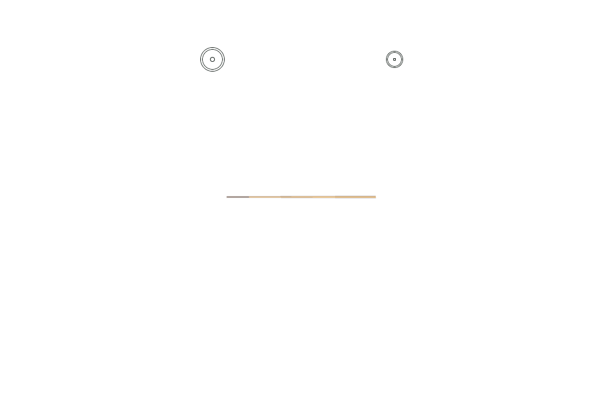
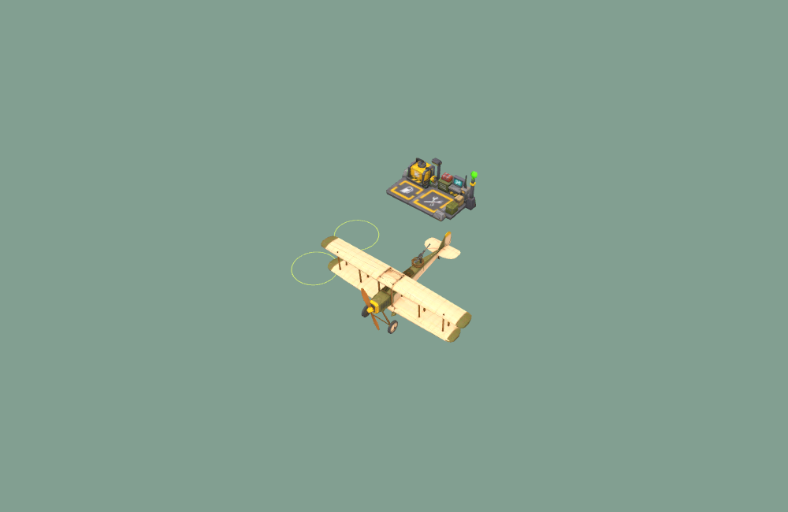

# Contraste, lit et accès à Alpha — version 289

Le viseur de direction des canons et la consigne souris gardent leurs positions
et dimensions. Leur cercle et leur point central sont maintenant blancs opaques,
avec un liseré sombre intérieur/extérieur pour le cercle et autour du point.
Ces choix sont fixes ; aucun réglage en jeu n’est ajouté.

Les traçantes ont un cœur ambre/orange et un contour brun sombre en mélange
normal. Les deux passes sont dessinées dans cet ordre, y compris en rendu
instancié : contour puis cœur. La largeur projetée du cœur vise un minimum de
2 pixels ; seule la largeur change, jamais la longueur de trajectoire ni les
collisions. Le brouillard et les obstacles continuent à masquer les tirs.
Les deux parties par calibre gardent les quatre lots instanciés existants.

Le nouveau [lit Drawer Bed](asset-pipeline.md#lit-de-réapparition-drawer-bed--version-289)
remplace le lit provisoire dans le monde, le fantôme de pose et la vignette
à l’achat. Sa collision correspond à ses dimensions et tourne avec le modèle.
Le joueur revient hors du lit du côté de son pied (+X local), même après rotation.
Le prix, le contrat personnel et les règles de passage au purgatoire sont conservés.

La station Alpha recule de **50,14 mm vers le nord** (−Z), sans déplacement
latéral ni changement de hauteur. Son centre est désormais à 14 unités acteur au
nord de l’origine d’Alpha, contre 5 auparavant. Le modèle agrandi empiétait sur
les cercles d’accès du pilote et du tireur du bombardier ; les deux zones sont
maintenant dégagées. Les appareils de départ restent à portée du service payant.
Les serveurs Node et Worker historique partagent la même position depuis le layout.

## Vérifications

- `test-base-service-access.mjs` reproduit le recouvrement d’un cercle d’accès avant
  correction, puis vérifie les deux postes et la portée du service après déplacement.
- `test-bed-model.mjs` vérifie la source approuvée, l’atlas, les ressources partagées
  monde/fantôme/achat, la collision et la réapparition à plusieurs angles.
- `test-tracer-contrast.mjs` vérifie palette, ordre des deux passes, largeur projetée,
  brouillard et occlusion ; `test-instanced-tracers.mjs` conserve ses contrôles de
  matrices, couleurs par instance, capacité, recyclage et nettoyage.
- Les contrôles WebGL comparent les traçantes ordinaires/instanciées sur blanc,
  leur atténuation dans les nuages et leur masquage par un obstacle. Les styles
  du HUD proviennent du véritable HTML du jeu.

La PR précise les commandes, le commit testé et le build Docker. Le rendu local
ne remplace pas un essai humain de pilotage ou un test WAN.

