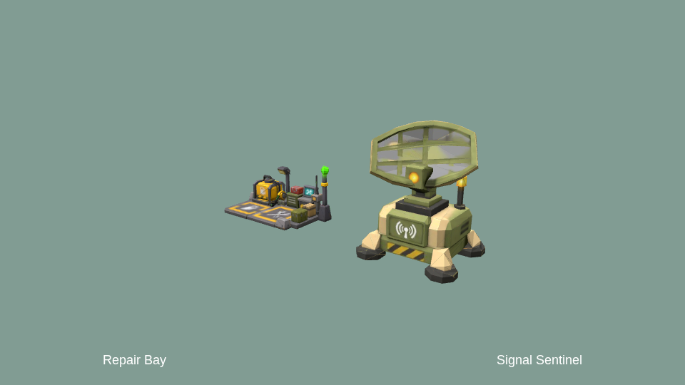
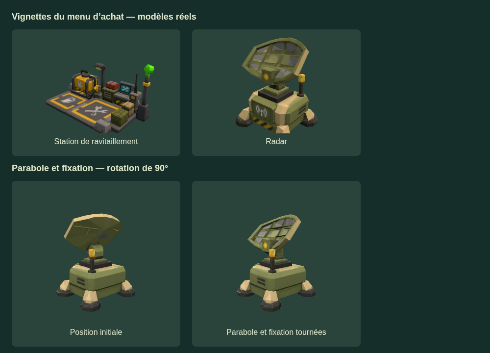

# Lisibilité et commandes — issue #171, version 284

Les personnages distinguent chute libre, descente suspendue sous parachute et
réception de 0,38 s avant de reprendre leur allure. Chaque modèle conserve ses
propres clips ; un clip dont le nom contient « fall » est utilisé s’il existe,
sinon une pose procédurale sert de repli. L’importeur conserve désormais ces
clips. Les imports embarqués actuels n’ont que repos/marche/course ; leurs GLB
sources ne sont pas fournis dans ce lot. Le même état `grounded`/`parachute`
alimente les personnages locaux et distants, sans modification du protocole.

La station Repair Bay remplace le ravitailleur et n’a plus de cercle au sol :
la sphère verte garde le rayon réel du service payant. Signal Sentinel remplace
le radar ; son antenne tourne à 1 rad/s autour de l’axe Y du palier, indépendamment
du socle. L’aperçu de pose reste immobile. Les deux modèles reposent à y=0.

Sources fournies par l’utilisateur (Meshy, sans génération) :

| Modèle          | SHA-256                                                            | Triangles |        Atlas navigateur |
| --------------- | ------------------------------------------------------------------ | --------: | ----------------------: |
| Repair Bay      | `c38cb36c8c26192f11badb1d6b706641c07c993a0bf82f4a60257b45edb59652` |     1 255 | JPEG 1K, 213 502 octets |
| Signal Sentinel | `a8533b347155c382e4bbef3deee890c92cdcaad87e75900cad3e96b2bf0d3e13` |       674 | JPEG 1K, 192 792 octets |

Import reproductible : `python scripts/import-stations.py refuel|radar SOURCE.glb`
(NumPy, trimesh, Pillow et SciPy). Originaux dans `assets/originals/stations/`,
hors Git. Géométrie et UV conservés ; seules les positions sont quantifiées à
0,0005 unité modèle et une copie de l’atlas est rééchantillonnée. Radar : sept
coques (parabole et fixation), 234 triangles, palier source `(0 ; −0,0354 ; 0)`, hauteur finale
4 unités modèle. Station : largeur 4 unités modèle. Échelle en jeu `MAP.ratio`.
L’image Docker d’optimisation a inspecté les deux GLB ; elle refuse la réduction
du monobloc articulé sans régions protégées. Vu leur faible nombre de triangles,
les originaux sont conservés, sans prétendre à un gain de FPS.

Le brouillard de distance blanc est léger (densité 0,018). Un voile blanc uniforme
sur l’image monte progressivement entre 40 % et 100 % du plafond, jusqu’à 85 %
d’opacité ; redescendre le dissipe. Le HUD reste devant ce voile. Chaque arme
accessible au poste dispose d’un arc au viseur ; HE/AP partagent un même canon,
donc un seul arc. Les rayons distinguent les armes. Le missile reste vide en vol,
puis se recharge pendant deux secondes selon la cadence de la salle. Les délais
serveur et la prédiction locale alimentent aussi le verrou de tir ; changer de
poste ne réinitialise pas la recharge d’une arme lourde.

ZQSD incline progressivement le Hind, avec un budget total de 45°, diagonales
comprises. Au relâchement, il revient progressivement à plat ; la souris garde
le cap horizontal. Le missile et la mitrailleuse partagent le tour complet et
les limites verticales −1,45 à 0 rad. Le serveur n’interdit plus les lancements
vers l’arrière. Le verrou local de recharge missile évite les départs et sons
prédits pendant la recharge serveur ; les sons restent liés aux projectiles émis.

La molette zoome la vue de dessus du Castor entre 0,15 et 0,8 m au-dessus du
véhicule (hauteur initiale 0,4 m, ancien maximum doublé). Les six jantes tournent
avec les pneus : 53 triangles des embouts d’essieu ont été réaffectés aux roues,
sans perte de triangles ni UV. `scripts/attach-castor-rims.py` reproduit cette
réaffectation depuis l’ancien module embarqué ; l’importeur GLB la fait aussi.
La direction s’inverse pendant le recul et le démarrage est adouci, vitesse
maximale conservée. Le message « Moucheron intercepté » est retiré.

## Vérifications

`node scripts/test-game-polish.mjs` couvre les limites diagonales, le retour à
plat, les virages avant/arrière, le zoom, le voile, les poses de deux apparences,
les stations et les arcs par poste. `test-support-vehicles.mjs` vérifie aussi un
lancement guidé vers l’arrière et le refus au-dessus de la butée. Les suites
Castor, personnages et armes lourdes restent applicables.

Suite complète `npm test`, build Node et validateur d’artefact réussis.
`test-polish-fire.mjs` exécute le verrou de tir client : silence pendant la
recharge, reprise du son au départ suivant et roquettes indépendantes du missile.
Chromium a vérifié une reconnexion UDP, puis deux clients ont observé les phases
distantes dans l’ordre chute → parachute → réception. Dans ce dernier contrôle,
les appels de rendu sont neutralisés pour isoler états et transport ; l’aperçu
WebGL ci-dessous vérifie séparément les modèles. Ce n’est pas une validation
visuelle humaine des animations en multijoueur. Les détails sont dans la PR.
Le confort de pilotage, l’écoute et une partie à deux sur réseaux distincts
restent des vérifications humaines, distinctes des contrôles locaux.

## Correctif des visuels — version 285

La fixation complète de la parabole suit maintenant sa rotation ; le socle et
la bague du palier restent fixes. Le menu d’achat utilise directement les mêmes
modèles et textures que les stations en jeu, à la place des anciens substituts.
`test-station-visuals.mjs` vérifie la répartition des 674 triangles, la rotation
et les modèles réellement utilisés par les vignettes.

Rendu WebGL vérifié des vraies vignettes et de deux orientations du radar ;
le support tourne avec la parabole et la bague reste fixe. Les vignettes montrent
la face avant (+Z) des modèles fournis. Suite complète et build Node vérifiés.

