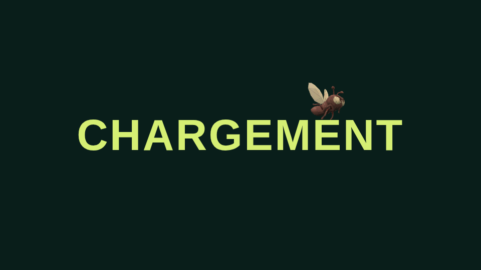
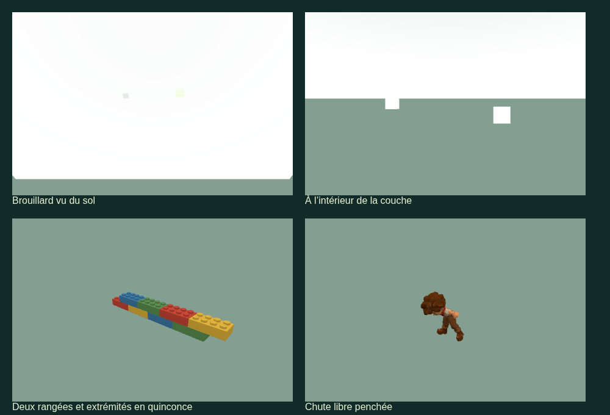
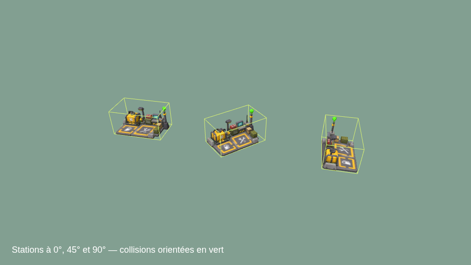

# Pilotage et lisibilité — lot #175, version 286

Périmètre validé dans [l’issue #175](https://github.com/simonjamain/i-am-a-moucheron/issues/175).
Ce lot complète [les premiers correctifs de lisibilité](game-polish-171.md).

## Castor et hélicoptère

Les roues avant du Castor gardent le même sens de braquage pour une commande
identique en avant et en recul. Le lacet du véhicule reste inversé en recul ;
le pivot sur place et le roulement opposé des côtés sont conservés.

Le Hind suit à nouveau le curseur horizontalement et verticalement. Pendant un
appui sur ZQSD ou les flèches, le clavier prend temporairement la main sur les
deux axes d’inclinaison ; au relâchement, la consigne souris reprend. Le cap
horizontal reste piloté à la souris. Le lissage et le plafond d’inclinaison réelle
de 45° demeurent communs aux deux axes, y compris pendant un grand changement de cap.

## Chargement initial

L’HTML affiche immédiatement « CHARGEMENT » sur fond vert/noir, avant les modules
du jeu et la sélection du salon/personnage. Les polices externes ne bloquent pas
ce premier écran. Une petite entrée charge en priorité Three et le vrai moucheron
Meshy animé, qui virevolte autour du texte pendant l’arrivée du graphe du jeu.

La sélection reste masquée jusqu’à l’initialisation du client, au premier dessin
du personnage choisi et à la fin des textures demandées. Un échec propose
« Réessayer » et recharge la page, afin de réinitialiser aussi les imports ESM
en échec. La connexion au salon conserve son état distinct. Sans WebGL, le texte
reste présent et le moteur logiciel existant demeure utilisable.

Le contexte WebGL temporaire du loader est détruit après chargement, avec son
canevas ; il ne reste pas un deuxième contexte animé pendant la partie.

## Éclairs de bouche et Hind

Un éclair utilise l’ancre de la bouche physique et son orientation, indépendante
de la dispersion balistique. Pendant ses 70 ms, il suit le canon et le véhicule.
La correction couvre les pilotes et tireurs locaux/distants, notamment le poste
arrière du bombardier biplan et les six tubes du Spitfire. Les postes fixes
utilisent également leurs ancres, y compris la coaxiale et l’obusier.

Les deux tubes Meshy du Hind tournent autour d’un nouveau pivot longitudinal ;
le pointage horizontal/vertical reste sur les pivots précédents. Deux ancres
sont placées aux centres des sorties sculptées. La géométrie et les UV ne sont
pas modifiés. Les départs de projectiles entraînent la rotation, qui monte puis
descend progressivement en régime. Un appui sans départ ne crée ni projectile
ni son supplémentaire. Le rendu distant suit les départs qu’il affiche.

## Station de ravitaillement

Repair Bay est agrandie ×3 sur ses trois axes : environ **36 mm de large et
18,47 mm de haut** dans la pièce, contre 12 et 6,16 mm. Le modèle réel sert au
monde, aux aperçus et aux vignettes d’achat. Sa boîte de collision locale tourne avec la station (correctif version 287),
y compris pour les coins vides de l’enveloppe sur les axes du monde ; les contraintes de support et de dégagement suivent
également cette taille. Le rayon de service payant et sa sphère verte restent
ceux des règles de ravitaillement.

## LEGO : dimensions, raccords et coût

| Règle                        | Valeur                                                           |
| ---------------------------- | ---------------------------------------------------------------- |
| Brique entière               | 24 mm de long, 12 mm de profondeur                               |
| Demi-brique                  | 12 mm de long                                                    |
| Hauteur d’un corps de brique | 6 mm, tenons conservés                                           |
| Mur                          | Deux rangées, environ 13,62 mm avec les tenons                   |
| Tronçon complet              | 48 mm, deux longueurs de brique                                  |
| Prix d’un tronçon complet    | 0,25 $ (25 centimes)                                             |
| Portion incomplète           | Conservée par pas de demi-brique, facturée au prorata au centime |

Les rangées sont décalées de 12 mm, extrémités comprises ; la rangée supérieure
dépasse d’une demi-brique afin d’emboîter les tronçons alignés. Les briques ne
s’étirent plus pour remplir un trait arbitraire. La longueur validée est arrondie
vers le bas au pas de 12 mm ; un trait plus court est refusé sans débit.

Les mêmes règles s’appliquent à pied et au Castor. Le premier point cliqué à pied
reste fixe pendant le choix de la fin. Les tronçons alignés et vivants sont réunis
uniquement pour le dessin : une reprise après portion partielle conserve ainsi
un calepinage continu. Les sections de dégâts, réparation, achat et navigation
restent indépendantes ; une section détruite ouvre bien une brèche. Les virages
conservent la construction libre et ne forcent pas le camion sur une grille.

Avant le premier clic au Castor, le fantôme est déjà derrière le véhicule,
orienté dans son axe. Après le clic, les briques apparaissent derrière lui par
pas de demi-brique ; chaque section complète est validée par le serveur. Un
second clic conserve la partie construite. Le ruban collant conserve son pas,
son minimum de 10 mm et son tarif de 1 $ par 20 cm.

## Brouillard spatial

La couche commence à **75 % de la hauteur du bureau**, soit 2,2125 m pour un
plafond à 2,95 m. Sa densité croît avec la hauteur. Les matériaux calculent
l’épaisseur traversée par chaque rayon : regarder vers le haut depuis le sol
révèle la couche, regarder horizontalement sous elle conserve la lisibilité.
Les objets vus depuis l’intérieur restent voilés. Un voile intérieur progressif
complète l’effet ; le HUD reste devant.

Le bureau n’avait pas de toit dessiné : un plafond visuel non solide donne aux
rayons de fond une terminaison dans ce même champ de brouillard. Il ne crée
aucun collider ni obstacle pour les projectiles. Le brouillard linéaire du
purgatoire est conservé ; le voile d’altitude n’y est pas affiché.

## Vérifications et limites

Les tests utilisent les interfaces existantes : physique, roues, modèles,
émission des effets, commandes de construction/prix et contrôleur d’aperçu.
`test-round2.mjs` couvre les comportements nouveaux ; les régressions existantes
sont actualisées aux dimensions et tarifs validés, sans supprimer leurs contrôles
de permissions, d’idempotence, de fonds, d’obstacles et de reset.

`e2e-loading.mjs` vérifie dans Chromium le chargement retardé, le moucheron animé,
la sélection masquée puis prête, l’échec d’une ressource et une nouvelle tentative.
Des rendus WebGL vérifient séparément le brouillard depuis le sol et de l’intérieur,
les shaders de sprites/objets instanciés, les briques et la pose de chute.
Les commandes et résultats finaux, le commit testé et le build Docker figurent
sur la PR. Les sensations de pilotage, l’écoute et le WAN ne sont pas déduits
à partir des seuls tests locaux.

## Collision orientée de la station — version 287

Une boîte englobante sur les axes du monde servait encore de collision après
rotation : à 45°, elle bloquait des coins vides. La boîte locale de Repair Bay
est désormais transformée avec le modèle ; l’enveloppe globale ne sert qu’aux
filtres larges. Marche, véhicules, appuis, atterrissage, rayons de tir/caméra,
projectiles balayés et validation de pose utilisent la forme orientée. Les
colliders ordinaires du bureau conservent leur comportement.

`test-refuel-collision.mjs` reproduit le blocage d’un personnage dans un coin
vide, puis contrôle plusieurs angles, translations, rayons, sphères balayées,
appuis et pose sur le toit. Un second cas rouge verrouille l’impossibilité de
poser un équipement sur un faux toit situé dans un coin de l’enveloppe globale.

