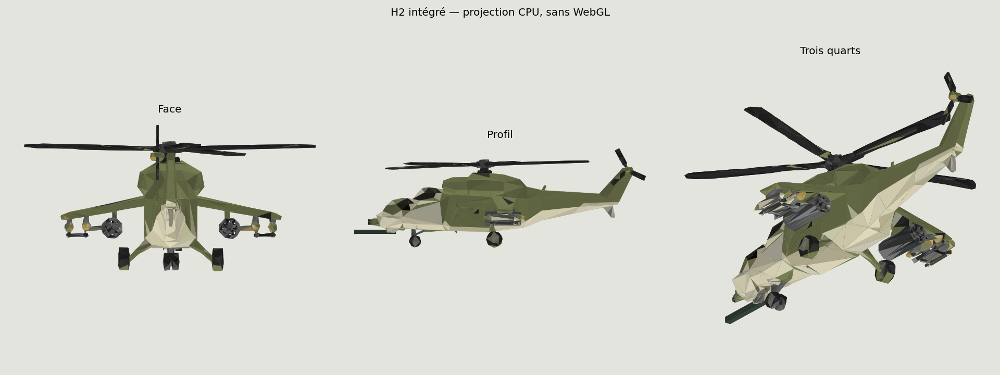

# Hélicoptère H2 — modèle issu du croquis

Le H2 reprend la fiche « Hélicoptère H2.png », vue trois quarts : silhouette
inspirée du Mi-24, verrières en tandem, ailes courtes, fuselage olive et crème,
train à roues. La couleur d'identification varie uniquement sur un disque coloré
au-dessus du H2 ; la coque garde ses couleurs intégrées.

Cette projection montre la géométrie chargée par `makeHelicopter`, pas une
capture WebGL. L'éclairage, la vue cockpit et le confort en partie restent à
valider dans un navigateur avec UDP.

## Provenance et conversion

- Génération Meshy image-to-3D : `01a1a814-67d0-73ec-833f-d66281bd2d07`.
- Source : 28 246 triangles, GLB téléchargé de 4 317 412 octets.
- SHA-256 : `148472fadbaf69bdb02fa365a7c3581e04d550eff2f55c6177e3d25183b513de`.
- Conversion : `python3 scripts/import-meshy-h2.py chemin/vers/h2.glb`, puis
  `npx prettier --write src/meshy-h2-data.js`.
- Dépendances hors ligne : trimesh 5.2.0, fast-simplification 0.2.0, scipy, Pillow.

Le convertisseur réduit à 3 600 triangles avant retrait des canons statiques,
tourne le nez vers -Z et normalise la longueur à 8,4 unités. Les roues touchent
le sol à -1,1 unité, correspondant à la garde physique existante. La géométrie
finale comporte **3 576 triangles et 7 meshes**, canon articulé compris, hors
inscriptions. Ces comptes ne constituent pas une mesure de FPS.

Les couleurs de texture sont intégrées aux triangles ; les détails de la texture
source sont simplifiés. Aucun GLB, décodeur ni service Meshy n'est chargé en jeu.
Les buffers sont partagés entre H2. Les pales et moyeux sont détachés du fuselage
pour la rotation principale autour de Y et celle de queue autour de X. Le rotor
de queue suit le même état moteur/carburant/puissance que le rotor principal.

Le canon statique généré est retiré, et le montage yaw/pitch du copilote conserve
son origine et sa sortie de tir. Les origines des roquettes/missiles, les postes,
les règles de vol, de dégâts, les volumes physiques et l'armement restent ceux des
[véhicules d'appui](support-vehicles.md). Les tubes illustrés ne sont pas des
volumes physiques de lancement ; leurs détails ne coïncident pas exactement avec
ces origines historiques. Les autres modèles restent inchangés.

## Vérification

`node scripts/test-h2-model.mjs` vérifie le budget, les coordonnées finies,
le partage des buffers, l'appui au sol, la rotation indépendante des deux rotors,
l'absence de recoloration de la coque, le disque coloré et le canon articulé. Le manifeste de l'assembleur inclut les deux
nouveaux modules pour Node, le paquet autonome et le Worker historique.

Essai humain restant : parking, décollage, vue cockpit/extérieure, deux joueurs
pilote/copilote, rotor local et distant, tirs, livrées et inscriptions. Aucun
environnement temporaire par PR n'est configuré ; utiliser `npm ci && npm start`.
