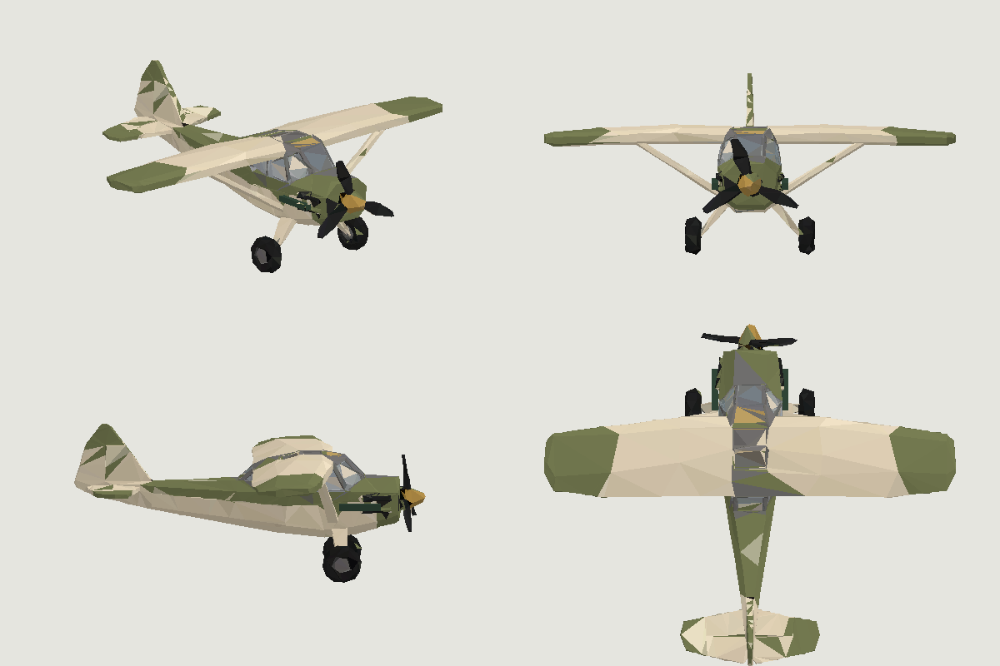

# Chasseur M1 — modèle issu du croquis

Le M1 utilise désormais le croquis « Chasseur M1.png » : aile haute haubanée,
fuselage olive et crème, cockpit bleu gris, nez jaune et train fixe. Les zones
olive prennent la couleur propre à chaque appareil via la livrée existante.
Les couleurs fixes sont intégrées aux sommets ; aucune texture ni requête Meshy
n’est nécessaire pendant une partie.

Cette image montre la géométrie effectivement chargée par `makePlane`, avec une
livrée olive pour comparaison au croquis. C’est une projection CPU, pas une
capture en jeu ni une validation de la lumière, du cockpit ou du pilotage.

## Provenance et fabrication

- Référence : fichier « Chasseur M1.png », vue de trois quarts recadrée.
- Génération Meshy image-to-3D : `01a1a800-d23f-700f-a4c7-6f5cff0ed1fc`.
- GLB source : 27 707 triangles, 4 035 492 octets ; le GLB reste
  téléchargeable depuis la tâche Meshy, il n’est pas chargé par le jeu.
- SHA-256 du GLB téléchargé :
  `f576a15791f513c5af145556f9c499d4a2ae64b4c4d4fc16f75e4b8077ce66c6`.
- Conversion hors ligne : `python3 scripts/import-meshy-m1.py chemin/vers/m1.glb`,
  puis `npx prettier --write src/meshy-m1-data.js`.
- Dépendances de conversion : trimesh 5.2.0, fast-simplification 0.2.0,
  scipy et Pillow. Elles ne sont pas des dépendances du serveur ni du navigateur.

Le convertisseur réduit le modèle à 2 800 triangles, tourne son nez vers -Z,
normalise l’envergure à 5,6 unités et garde le bas du train à -1,05 unité.
Il sépare l’hélice, les ailes et les surfaces de peinture, puis intègre les
couleurs de la texture aux triangles. Les détails sont simplifiés et la texture
originale n’est donc pas reproduite pixel par pixel.

`src/m1-model.js` partage les buffers de géométrie entre appareils et ajoute les
deux canons et leurs sorties de tir. Total : **2 824 triangles et 8 meshes** par
M1, hors inscriptions. Ce sont des comptes de géométrie, pas des mesures de FPS.
L’hélice garde son pivot indépendant ; l’état d’aile endommagée réduit le groupe
correspondant. Les règles de vol, de dégâts et les volumes physiques restent
ceux de la [flotte](scale-fleet-weapons.md).

Le Stuka et le Spitfire conservent leur ancienne base procédurale. Le nouveau
module et les données sont inscrits au manifeste de l’assembleur pour Node,
le paquet autonome et la compatibilité Worker historique.

## Vérification

`node scripts/test-m1-model.mjs` vérifie les dimensions, le partage des buffers,
le budget de triangles/meshes, les valeurs finies, les livrées, la rotation de
l’hélice et l’affichage des dégâts. `scripts/test-scene.mjs` vérifie l’appui
sur le bureau ; `scripts/test-muzzle-alignment.mjs` vérifie les sorties des tirs.

À vérifier en navigateur WebGL/UDP : M1 au parking, décollage, vues cockpit et
extérieure, hélice locale et distante, livrées et noms, tirs, aile endommagée.
Comparer aussi le Stuka et le Spitfire. Un environnement temporaire par PR n’est
pas configuré ; la PR consigne les contrôles réellement exécutés.
