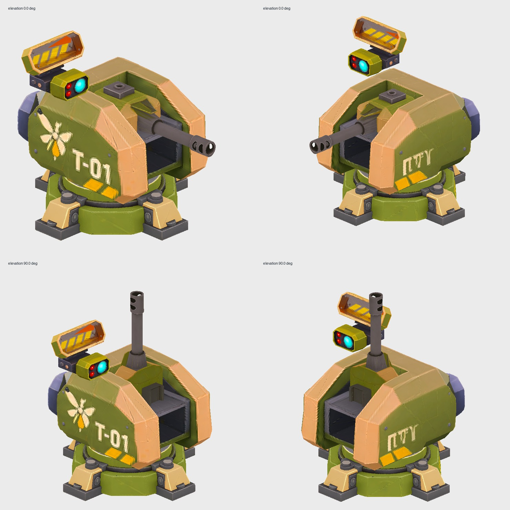
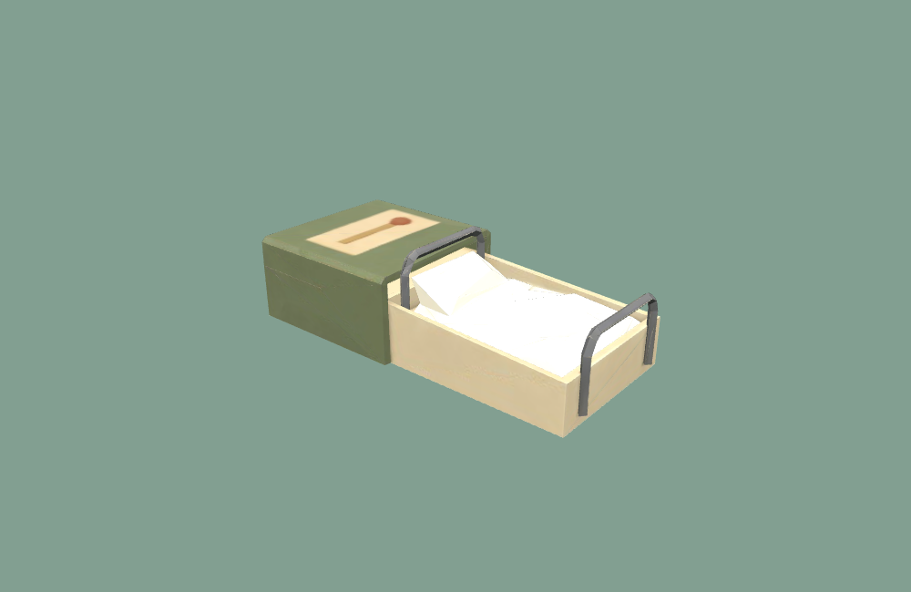
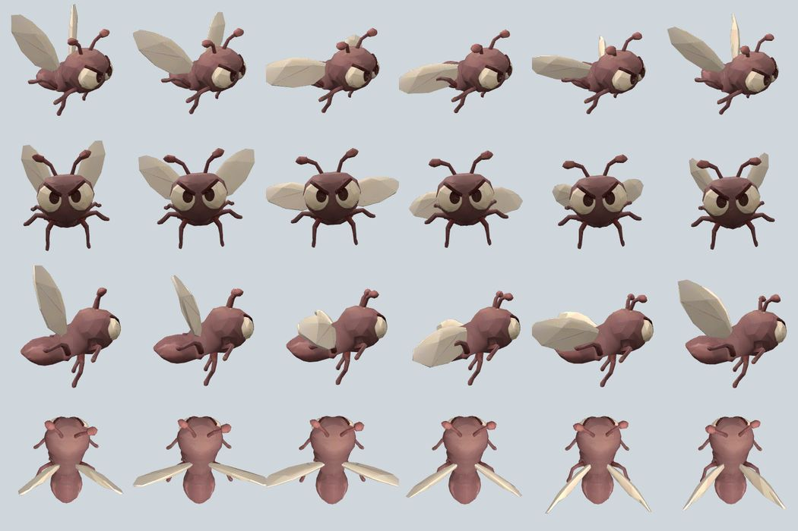
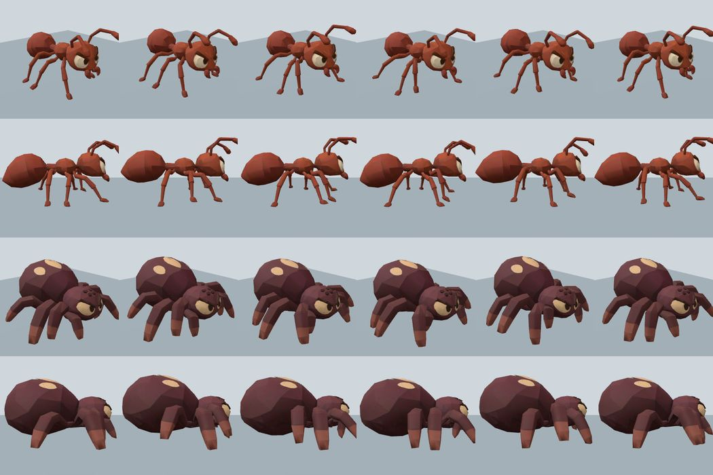
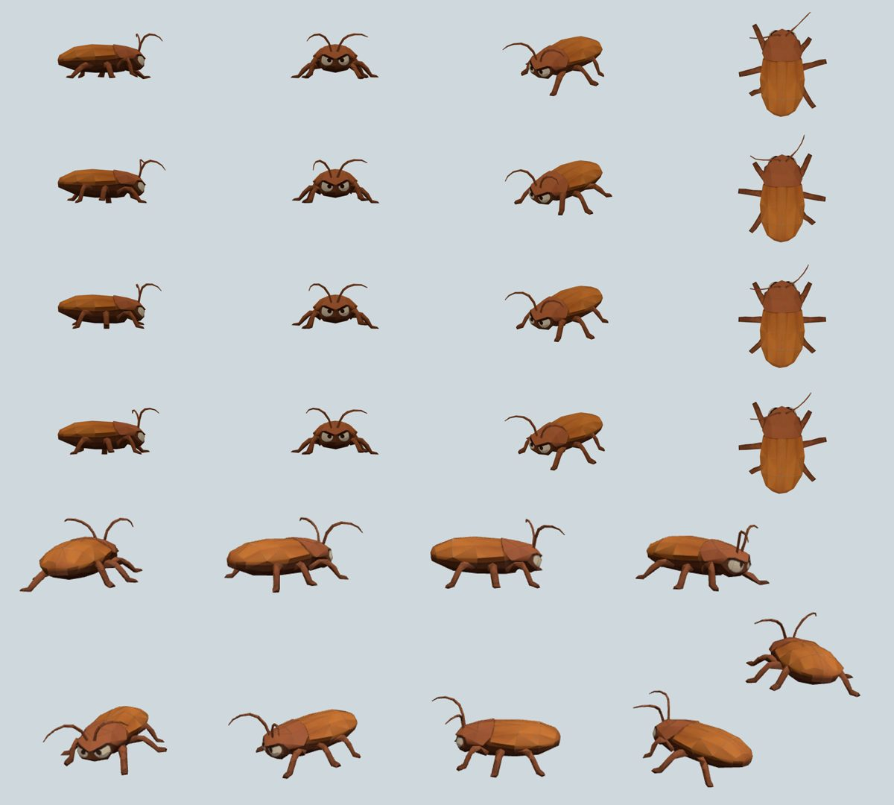
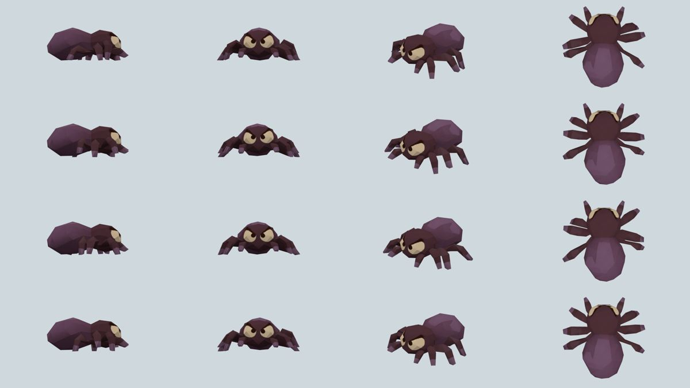
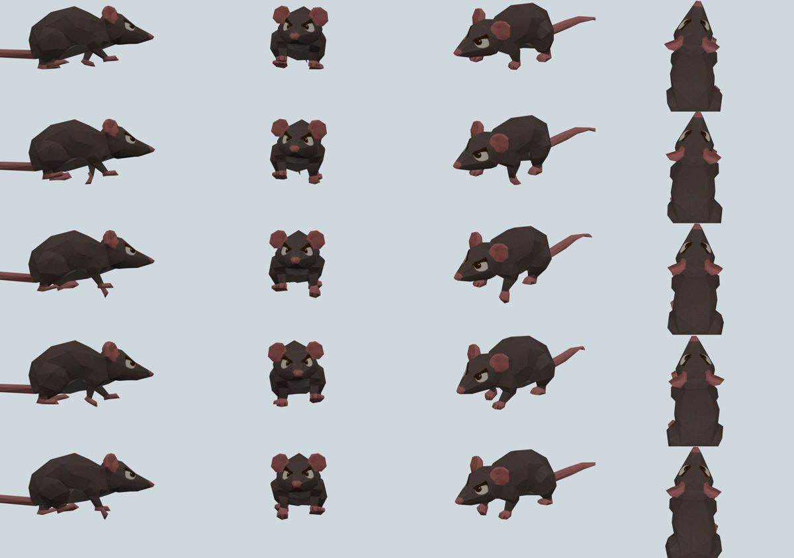
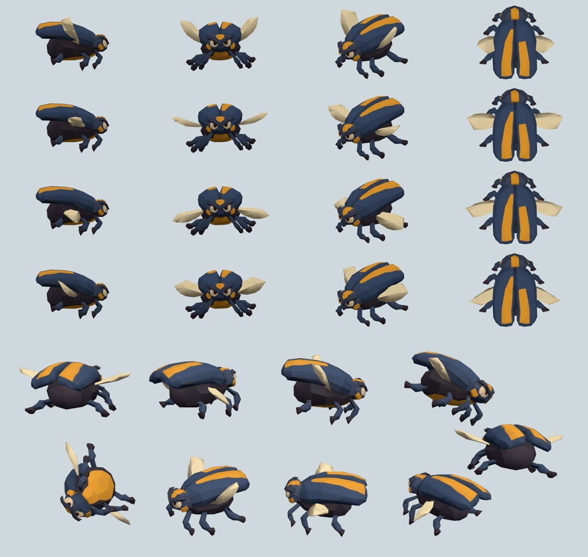
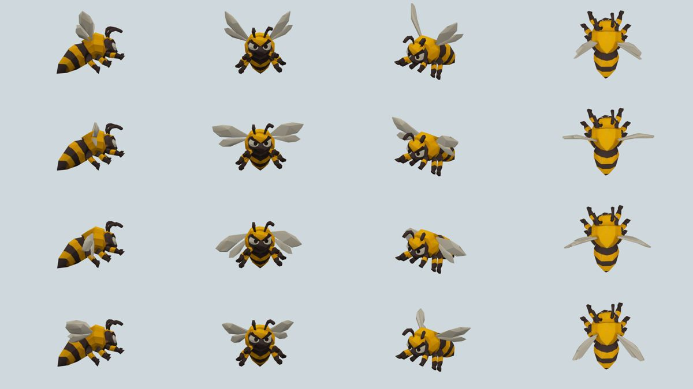
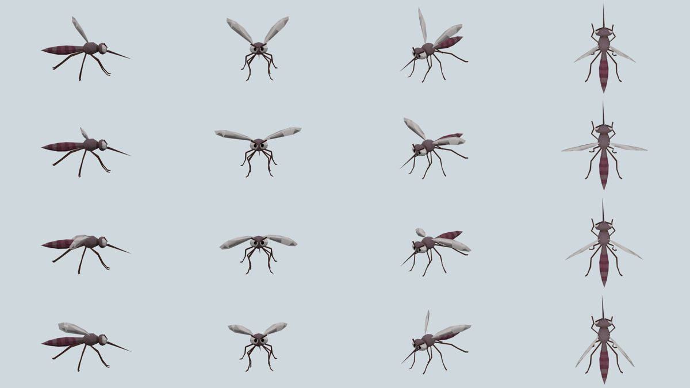

# Catalogue des modèles 3D

Provenance, import et articulations de chaque modèle intégré. Règles communes
(validation Meshy, conventions d'import, optimisation) : [pipeline des assets](asset-pipeline.md).
Tous les originaux sont **hors Git** (`assets/originals/…`) ; leur SHA-256 complet est
épinglé dans le script d'import et recopié dans l'en-tête ou le champ `sourceSha256` du
module généré (abrégé ici). Sauf mention, tous les triangles et UV d'origine sont gardés
et aucune simplification n'est appliquée.

## Véhicules

Les véhicules sont des GLB Meshy remodelés et fournis par l'utilisateur : **un seul
maillage texturé** dont chaque pièce mobile est un **îlot séparé**. Leur texture d'origine
est la livrée : aucune couleur par joueur ni pastille n'est ajoutée, et les dégâts se
voient par la fumée, jamais par un changement de forme. Règles de jeu, postes et
armement : [flotte et armes](scale-fleet-weapons.md).

| Id (`src/fleet.ts`)   | Source (SHA-256)                                    | Triangles | Import                                                  | Module, rig                                             |
| --------------------- | --------------------------------------------------- | --------: | ------------------------------------------------------- | ------------------------------------------------------- |
| `fighter`             | `chasseur_biplan.glb` (`4ca14796…228a`)             |     2 702 | `import-meshy-vehicle.py biplane`                       | `meshy-biplane-data.ts`, `biplane-model.ts`             |
| `bomber`              | `bombardier_biplan.glb` (`62a9205e…8023`)           |     1 762 | `import-meshy-vehicle.py biplanebomber`                 | `meshy-biplane-bomber-data.ts`, `biplane-model.ts`      |
| `lightfighter` (M1)   | `Meshy_AI_Olive_Scout_Plane` (`d4115c13…7387`)      |     2 357 | ancienne entrée `fighter` de l'importeur (voir limites) | `meshy-m1-data.ts`, `m1-model.ts`                       |
| `medbomber` (B3)      | `bomber.glb` (`a50363b8…4307`)                      |     5 797 | `import-meshy-vehicle.py bomber`                        | `meshy-b3-data.ts`, `b3-model.ts`                       |
| `interceptor` (Stuka) | `Meshy_AI_Desert_Sparrow` (`6290811f…9ade`)         |     3 261 | `import-meshy-vehicle.py interceptor`                   | `meshy-stuka-data.ts`, `meshy-rig.ts`                   |
| `spitfire`            | `Meshy_AI_Vintage_Fighter_Plane` (`b18e5558…26c4`)  |     3 002 | `import-meshy-vehicle.py spitfire`                      | `meshy-spitfire-data.ts`, `meshy-rig.ts`                |
| `tank` (T3)           | `Meshy_AI_Desert_Vanguard` (`fb105cc1…86e9`)        |     3 833 | `import-meshy-vehicle.py tank`                          | `meshy-tank-data.ts`, `meshy-rig.ts`                    |
| `flaktruck` (D2)      | `Meshy_AI_Towable_Anti_Aircraft` (`3861d4bf…18ed`)  |     4 689 | `import-meshy-vehicle.py flaktruck`                     | `meshy-flaktruck-data.ts`, `meshy-rig.ts`               |
| `helicopter` (H2)     | `Meshy_AI_Desert_Viper_Helicopt` (`488832fc…6a9a`)  |     5 102 | `import-meshy-vehicle.py helicopter`                    | `meshy-h2-data.ts`, `h2-model.ts`                       |
| `castor` (G1)         | `Meshy_AI_Tactical_Rescue_Rover…` (`b211b423…c466`) |     3 700 | `import-meshy-castor.py`                                | `meshy-castor-data.ts`, `castor-model.ts`               |
| `flyingcastor`        | `Meshy_AI_Rescue_Rotorcraft…` (`dfcd21c0…e691`)     |     2 767 | `import-meshy-flying-castor.py`                         | `meshy-flying-castor-data.ts`, `flying-castor-model.ts` |

Les images de conception de la flotte d'origine restent dans
[`vehicle-references/`](vehicle-references/) :
[Stuka](vehicle-references/stuka.png), [Spitfire](vehicle-references/spitfire.png),
[char](vehicle-references/tank.png), [DCA mobile](vehicle-references/flaktruck.png).

### Import articulé (`import-meshy-vehicle.py`)

`python3 scripts/import-meshy-vehicle.py VÉHICULE SOURCE.glb [--debug FICHIER]` soude
les sommets pour retrouver les îlots, puis range chacun dans un nœud articulé selon la
spécification du véhicule (sélection d'îlots, pivots, sens des canons). L'avant Meshy −X
est tourné vers −Z sans miroir ; l'échelle est calée sur l'envergure (biplans 5,6 et
11,3, M1 5,6, B3 11,3, Spitfire 6,2, Stuka 7,7) ou la longueur (T3 4,3, D2 8,6, H2 7,5),
roues au niveau −`gear`. La texture 4 096 px devient un JPEG de 1 024 px. `--debug`
exporte îlots et groupes pour un rendu de contrôle surligné.

`src/meshy-rig.ts` construit la hiérarchie (`data.rig`) : chaque nœud est un pivot dans
le repère de son parent, avec sa rotation de repos. Les canons sont stockés alignés sur
−Z (ce qu'attend `aimGun`) et leurs bouches (`data.anchors`) sont sur l'axe passant par
le pivot d'élévation. `src/meshy-texture.ts` partage buffers, matériaux et atlas entre
exemplaires. L'importeur écrit aussi `src/vehicle-anchors.ts`, partagé client/serveur,
pour que la physique parte des pièces dessinées : canon du T3 (`tankBarrelOrigin`),
attelage et canons du D2 (`mobileBarrelOrigin`, `trailerGunPivot`), enveloppes du
tracteur et de la remorque (`sweptVehicle`), armes du H2 (`heliWeaponOrigin`).

Pièces articulées :

- **Chasseur biplan** : hélice ; une mitrailleuse centrale sculptée sur le capot, unique
  bouche du pilote (`pilotMuzzles`).
- **Bombardier biplan** : hélice de nez ; arme du mitrailleur arrière (îlots 12, 14, 23)
  en lacet sur son anneau puis en élévation, tournée vers l'arrière au repos.
- **M1** : hélice et deux mitrailleuses de nez sculptées comme bouches ; aile dans la coque.
- **B3** : deux hélices, ailes, tourelles dorsale, de queue (vers l'arrière au repos) et
  ventrale (vers le bas), dans l'ordre des postes.
- **Stuka** : hélice, ailes en mouette, bombe ventrale dans la coque ; deux bouches au
  bord d'attaque à 40 % de l'envergure (pas de canon sculpté).
- **Spitfire** : hélice, ailes, six canons d'aile sculptés comme bouches.
- **T3** : tourelle (lacet) portant le canon, la coaxiale et la mitrailleuse de toit sur
  son affût (lacet + élévation) ; mitrailleuse de caisse du pilote.
- **D2** : remorque pivotant à l'attelage, affût tournant, canons jumeaux en élévation.
- **H2** : rotor à cinq pales (axe Y), rotor de queue (axe X), canon de nez du copilote.

Retouches appliquées ensuite aux modules, sans changer triangle, UV ni texture :
`rig-aircraft-wheels.mjs` et `rig-biplane-wheels.mjs` détachent les roues principales
des avions ; `split-vehicle-parts.mjs` extrait les roues du D2 (six de tracteur, quatre
de remorque) et les chenilles, galets, barbotins et pignons du T3 ; `rig-tank-gun.mjs`
place le pivot du canon du T3 à l'avant de la tourelle et sépare le tube
(`cannonBarrel`, seul à reculer) du masque (`cannonGun`) ; `rig-tank-hubs.mjs` range les
moyeux du T3 dans leurs roues.

### Castor G1

`python3 scripts/import-meshy-castor.py SOURCE.glb` trouve les 158 îlots, reconnaît les
six pneus et les cinq pièces de la tourelle de toit (l'import échoue sinon), tourne le
modèle de −X vers −Z, l'échelonne à 6,1 unités de long avec le contact des roues à −0,8,
et enregistre `body`, `wheel0`…`wheel5` (moyeu, axe X, rayon 0,568 →
`CASTOR_WHEEL_RADIUS`), `turret` (lacet) et `gun` (élévation), bouche au bout du canon.
Texture 2 048 px → JPEG 1 024 px. `scripts/attach-castor-rims.py` rattache les six
enjoliveurs extérieurs à leur pneu. Le mât caméra et l'antenne restent dans la coque.

### Castor volant

`PYTHONPATH=scripts python3 scripts/import-meshy-flying-castor.py SOURCE.glb` retient
comme rotors les îlots au-dessus des pylônes (Y source ≥ 0,165) proches de l'axe avant
(X ≈ −0,25, 5 îlots) ou arrière (X ≈ +0,28, 8 îlots), sinon échoue ; tourne −X vers −Z,
échelonne à 9 unités de long, patins à −1, et enregistre `body`, `rotorFront`,
`rotorRear` autour de leur axe vertical. `src/flying-castor-model.ts` fait tourner les
deux rotors en sens opposés ; la fumée de dégâts sort sous chaque moyeu.

### Vérifier

`test-meshy-vehicles.mjs` (empreintes, triangles, contact au sol, hiérarchies, bouches
dessinées = origines de la physique), `test-meshy-textures.mjs` (atlas, indices, UV),
`test-meshy-fleet.mjs` (maillages, partage des buffers, ailes, remorque),
`test-vehicle-identity.mjs`, `test-muzzle-alignment.mjs`, `test-aircraft-wheels.mjs`,
`test-biplane-models.mjs`, `test-m1-model.mjs`, `test-b3-model.mjs`, `test-h2-model.mjs`,
`test-castor-meshy.mjs`, `test-castor-wheels.mjs`, `test-flying-castor.mjs`. Ces tests ne
remplacent pas un essai WebGL : rendu, tirs de chaque poste, braquage de la remorque,
rotors, performances avec plusieurs véhicules.

## Défenses et installations

### Tourelle T-01

Quatre modèles Meshy indépendants (Smart Topology), importés par
`python3 scripts/import-meshy-t01.py --sources assets/originals/t01 --output src
--texture-size 1024` depuis `socle.glb`, `tete.glb`, `canon.glb`, `capteur.glb` (les
exports Meshy horodatés ne suivent pas l'ordre de génération : socle `…102715`, tête
`…103356`, canon `…103334`, capteur `…103241`). Modules `src/meshy-t01-*-data.ts`, atlas
2 048 px rééchantillonnés en WebP 1 024 px.

| Pièce         | Tâche Meshy                            | Triangles | SHA-256         |
| ------------- | -------------------------------------- | --------: | --------------- |
| Socle fixe    | `01a1b589-f91a-74d7-9cfd-af1e09fc7fcf` |     3 149 | `cadf1616…c695` |
| Tête rotative | `01a1b58b-8015-7247-b17b-351c9946a143` |     4 380 | `105bef2d…9472` |
| Bloc canon    | `01a1b58b-8f11-7588-92a6-80bdb540bbe5` |     3 684 | `b29849fb…a743` |
| Capteur/radar | `01a1b58b-9c0b-74a9-bb5c-269a36d9169c` |     2 413 | `5f5882e8…467c` |

Assemblage (`src/sentry-model.ts`) : socle immobile ; tête et radar sur un groupe de
lacet (360°) ; canon sur un groupe d'élévation de −10° à +90°
(`SENTRY_MIN_ELEVATION`, `SENTRY_MAX_ELEVATION`). Chaque module a son propre axe avant
(tête +X, canon −X, radar +Z), aligné sur −Z par une transformation propre. Le radar est
monté sur le côté pour laisser passer le canon à +90°. Une échelle uniforme
`SENTRY_SCALE = 0,22` à la racine donne environ 1,5 cm et un canon de 9 mm comme celui du
Castor ; `SENTRY_MUZZLE_HEIGHT` en découle. Le tir part de la bouche `bouche-canon`.
Contrôles : `test-sentry-meshy.mjs`, `test-sentry-model.mjs`, `test-sentry-scale.mjs`.

### Tourelle Gatling

Modèle « Sentinel Sentry » découpé par `scripts/import-meshy-gatling.py` : voir
[la Gatling](gatling-turret.md#modèle-meshy-et-animation).

### Canon anti-matériel (obusier)

- Source : `assets/originals/howitzer/field-howitzer.glb` (`5d30ba36…6c5c`), un maillage
  de 2 922 triangles en 77 coques déconnectées. Axes : tube vers −X, essieu selon Z.
- `PYTHONPATH=scripts python3 scripts/import-howitzer.py <GLB>` affecte chaque coque
  entière à une pièce (règles par boîte englobante, comptes verrouillés) : affût fixe
  1 315 triangles, roue gauche 356, roue droite 372, berceau élevable (culasse, recul,
  tourillons, bouclier) 558, tube reculant 321. Texture JPEG 1K, `src/howitzer-data.ts`.
- Pivots : milieu de l'essieu (pointage horizontal, roues de rayon 0,082 qui tournent en
  sens inverse sans glisser), tourillons en (0,157 ; 0,045), bouche au centre du frein
  de bouche. Roues de 1,10 m de référence, canon d'environ 6,4 × 2 m.
- `src/howitzer-model.ts` : pointage 45°/s, élévation 30°/s entre −5° et +40° (au-delà
  la culasse traverserait les flèches), recul du tube de 30 % en 0,06 s, retour en 0,6 s.
  `src/howitzer-geometry.ts` (sans three.js) reprend les pivots pour que l'obus parte de
  la vraie bouche (écart < 2 cm). Contrôles : `test-howitzer.mjs`,
  `test-antitank-shell.mjs`.

### DCA fixes

`python3 scripts/import-fixed-dca.py dca|dcaRapid|dcaHeavy SOURCE.glb` vérifie
l'empreinte, tourne les tubes vers −Z, sépare par coques l'embase, le bloc orientable et
les tubes, et réaligne les tubes à l'horizontale au repos. Texture JPEG 1 024 px au plus,
pivots et bouches en mètres de référence ; modules `src/fixed-dca-<type>-data.ts`,
assemblage `src/fixed-dca-model.ts`.

| Type       | Source                                            | SHA-256         | Embase / bloc / tubes |
| ---------- | ------------------------------------------------- | --------------- | --------------------: |
| `dca`      | `Meshy_AI_Twin_Thunder_Cannon_1114220423_texture` | `04a00911…0946` |     1 030 / 965 / 342 |
| `dcaRapid` | `Meshy_AI_Quad_Flak_Sentinel_1114215256_texture`  | `615b5377…2f62` |     970 / 1 108 / 248 |
| `dcaHeavy` | `Meshy_AI_Ironclad_Howitzer_1114215249_texture`   | `6ec4c317…1888` |     778 / 1 092 / 306 |

Les quatre manchons de la DCA haute cadence (dont les deux supérieurs, plus en arrière)
suivent les tubes ; la culasse du Flak lourd fait partie du groupe inclinable.

### Stations de service

`python3 scripts/import-stations.py refuel|radar SOURCE.glb` importe
`Meshy_AI_Repair_Bay_Refuel_Sta…` (`c38cb36c…b652`, 1 255 triangles, 4 m de large) et
`Meshy_AI_Signal_Sentinel…` (`a8533b34…0e13`, 674 triangles, 4 m de haut) dans
`src/meshy-refuel-data.ts` et `src/meshy-radar-data.ts`. Le radar détache son antenne
et sa fourche (sept îlots, compte vérifié) au-dessus du roulement vertical. Assemblage :
`src/station-model.ts` ; contrôle : `test-station-visuals.mjs`.

### Brique du mur Castor

Brique LEGO 2×4 générée par Meshy (image-to-3D, tâche
`01a1ba16-7dde-758d-82fb-74eb5b54fa80`, référence validée `67e97d4a…c425`) **sans
texture** : le jeu colore chaque instance. GLB `42c02791…65c7`, 844 triangles. Tenons
vers +Y, longueur X, profondeur Z ; en jeu, pas `BRICK_PITCH` 24 mm, rangée `BRICK_ROW`
6 mm, profondeur `BRICK_DEPTH` 12 mm. `PYTHONPATH=scripts python3
scripts/import-meshy-brick.py <GLB>` écrit `src/meshy-brick-data.ts` ; contrôle :
`test-brick-model.mjs`.

### Lit de réapparition

`Meshy_AI_Drawer_Bed_1113100645_texture.glb` (`3ddaba9b…4e49`), 310 triangles, statique
(tiroir déjà ouvert). L'outil Docker n'en retirait que six triangles en grossissant le
fichier : l'original est importé. `python3 scripts/import-bed.py SOURCE.glb` écrit
`src/meshy-bed-data.ts` (positions quantifiées à 0,0005, texture JPEG 1K). En jeu
`src/bed-model.ts` : 12 × 3,381 × 5,55 mm, géométrie partagée entre lits, fantômes et
achat ; réapparition à 2,6 unités modèle du centre côté +X, tournée avec le lit.
Contrôle : `test-bed-model.mjs`.

## Personnages joueurs

Huit modèles Meshy + Mixamo fournis, riggés et animés par l'utilisateur. Ordre du
sélecteur dans `src/character-appearances.ts` (le premier est le défaut et le repli) ;
les noms ne sont lus que par les lecteurs d'écran.

| Id          | Nom          | Original (`assets/originals/character/`) | SHA-256         | Os  | Triangles |
| ----------- | ------------ | ---------------------------------------- | --------------- | --- | --------: |
| `cowboy`    | Aventurier   | `cowboy-boy.glb`                         | `29cbb213…ed0d` | 44  |     1 556 |
| `frontier`  | Aventurière  | `curly-frontier-girl.glb`                | `abc715df…b27a` | 44  |     1 554 |
| `sky-pilot` | Aviateur     | `little-sky-pilot.glb`                   | `740ecc0a…ed8f` | 44  |     1 536 |
| `toby`      | Mécanicien   | `toolbox-toby.glb`                       | `db97a0ab…2b1a` | 44  |     1 562 |
| `sunny`     | Mécanicienne | `sunny-workshop-girl.glb`                | `da6fd6ce…8d49` | 60  |     1 562 |
| `aviator`   | Aviatrice    | `little-aviator.glb`                     | `222ea403…5f5e` | 44  |     1 690 |
| `signaler`  | Opérateur    | `skyline-signaler.glb`                   | `4e79dbe4…bead` | 46  |     1 662 |
| `operator`  | Opératrice   | `headset-engineer.glb`                   | `99385d02…602b` | 42  |     1 670 |

- Import : `PYTHONPATH=scripts python3 scripts/import-character.py <id> <GLB>` écrit
  `src/character-data.ts` (défaut) ou `src/character-<id>-data.ts` : positions/UV
  float32, poids sur 8 bits, rotations int16, translation des hanches seule, texture de
  base JPEG 1 024 px. Clips gardés : `Idle_12`, `Walking`, `Running` pour le défaut ;
  `Walking`, `Running` pour les autres.
- Chargement : seul le défaut est dans le graphe initial ; les autres sont des `import()`
  dynamiques, chargés quand le sélecteur les montre ou qu'un joueur les porte, le défaut
  étant affiché puis remplacé sur place (`setAppearance`).
- Rendu (`src/character-model.ts`) : géométrie, matériau et clips partagés par apparence,
  os et mixeur par joueur, hauteur commune `CHARACTER_HEIGHT` 1,7 m. Allure (`GAIT`) :
  repos sous 0,35 m/s, course dès 3 m/s, lecture liée à la vitesse. Sans clip de repos,
  une pose de liaison sert de repos, bras baissés. Les poses absentes (assis, chute,
  parachute) orientent les os en espace monde ; `turnToward()` lisse l'orientation.
- Le sélecteur de l'accueil (`src/appearance-picker.ts`) dessine dans le canevas du jeu
  (viewport et ciseaux sur son rectangle) et recompose l'ombre latérale et le panneau
  (`SIDE_SHADE`, `PANEL_TINT`) : un second contexte WebGL ou une relecture de pixels
  ralentissaient toute la partie.
- Contrôles : `test-character.mjs`, `test-appearances.mjs`.

## Créatures

Modèles Meshy fournis par l'utilisateur, déjà riggés (SmartRig), **sans clip** sauf le
rat. Chaîne commune : `src/rigged-creature.ts` (décodage, rig, cuisson, `defineCreature`),
`src/creature-batch.ts` (texture d'animation de sommets, un `InstancedMesh` par espèce,
matériau de profondeur pour les ombres), puis `src/midge-batch.ts`,
`src/walker-batch.ts` (`WALKERS`) ou `src/flyer-batch.ts` (`FLYERS`). Les cadavres, les
âmes du purgatoire et le rendu sans WebGL utilisent un `SkinnedMesh` réel du même rig
(`graphics.insect`). Aucun niveau de détail : toutes les créatures vivantes utilisent leur
modèle Meshy. Les textures 2K deviennent des JPEG de 512 px. Tête vers +Z, Y vers le haut,
pieds à y = 0 dans la source.

| Espèce             | Modèle Meshy                      | SHA-256         | Triangles / os | Import                          | Échelle | Zone de tir           |
| ------------------ | --------------------------------- | --------------- | -------------- | ------------------------------- | ------: | --------------------- |
| moucheron          | Angry Little Fly                  | `5db0deca…f404` | 1 624 / 38     | `import-midge.py`               |     0,8 | `MIDGE_SPHERE_RADIUS` |
| fourmi             | Red Ant Warrior                   | `12064094…b4cd` | 2 074 / 52     | `import-creature.py ant`        |     0,6 | `ANT_HIT`             |
| araignée           | Spotted Velvet Spider             | `e8d8f32d…3faa` | 1 471 / 30     | `import-creature.py spider`     |     0,6 | `SPIDER_HIT`          |
| cafard             | Low Poly Cockroach                | `4ca70cae…5fc3` | 490 / 40       | `import-creature.py roach`      |    0,52 | `ROACH_HIT`           |
| bébé araignée      | Grumpy Spider                     | `eaeaff76…96da` | 280 / 29       | `import-creature.py spiderling` |     0,5 | `SPIDERLING_HIT`      |
| rat                | Low Poly Mouse                    | `fa7bf0c8…3eae` | 420 / 27       | `import-rat.py`                 |     3,5 | `RAT_HIT`             |
| scarabée (`brute`) | « Low Poly Cockroach » (scarabée) | `a7d151ca…aa1f` | 598 / 48       | `import-beetle.py`              |    0,75 | `BEETLE_HIT` (sphère) |
| abeille (`guard`)  | Angry Low Poly Bee                | `a126aa44…821d` | 582 / 45       | `import-bee.py`                 |    0,75 | `BEE_HIT`             |
| moustique          | Low Poly Mosquito                 | `c13dff6e…1c15` | 478 / 62       | `import-mosquito.py`            |       1 | `MOSQUITO_HIT`        |

Les scripts s'appellent avec `PYTHONPATH=scripts python3 scripts/<script> [espèce] <GLB>`
et écrivent `src/<espèce>-data.ts` ; la pose est dans `src/<espèce>-model.ts`. Les zones
de tir sont des ellipsoïdes du corps sans pattes ni ailes (sphère pour le scarabée),
partagées entre proxys instanciés et rigs (`src/insect-hits.ts`). Le facteur d'espèce
de `src/scale.ts` fixe ensuite la taille au bureau.

### Corrections de rig à l'import

- **Moucheron** : ailes pondérées par Meshy sur l'abdomen ; l'import ajoute `Wing_L`
  (+X) et `Wing_R` (−X), enfants du thorax `Bone_003`, charnière aux sommets les plus
  internes de chaque coque d'aile, liés à 100 %.
- **Scarabée** : même ajout d'os d'ailes (enfants de `Bone_002`) ; la carapace cède au
  thorax ses poids sur les os de pattes. Il vole élytres fermées (elles font partie de
  la coque du corps).
- **Abeille, moustique** : les os d'ailes Meshy sont gardés, chaque aile suit son os
  racine à 100 % ; le corps cède ses poids d'ailes et de pattes, chaque patte ne garde
  que sa chaîne.
- **Cafard, bébé araignée** : chaque coque de patte ne garde que sa chaîne, le reste va
  au moyeu `Bone_001` ; l'option `alias` replie la chaîne en double de la patte 2 +X du
  bébé (`Bone_008`/`007`/`006` sur `Bone_014`/`013`/`012`).
- **Rat** : export Blender (armature à 0,01, échelle constante sur `Hips`) ; l'import
  remet le squelette en mètres-modèle et rééchantillonne le clip « Armature|Unreal
  Take|baselayer » (1 s, 31 clés) en transformations monde par os.

### Animation

- **Volants** (`midge-model.ts`, `beetle-model.ts`, `bee-model.ts`, `mosquito-model.ts`) :
  cycle procédural d'une seconde cuit en texture (moucheron 7 battements, scarabée 6,
  abeille 12, moustique 15), battement sur l'horloge partagée avec une phase par insecte ;
  le client oriente le proxy vers son déplacement.
- **Marcheurs** (`walker-gait.ts`, `walker-batch.ts`) : pieds plantés pendant 60 % du
  cycle puis levés en arc, cinématique inverse à deux os (`solveLeg`) ; fourmi et cafard
  en tripode, araignée et bébé en tétrapode alternée ; phase avancée de
  `distance / foulée` et plafonnée (`maxRate`), glissement vers une pose de repos à
  l'arrêt. Le cafard et le bébé sont relevés (`raise`) pour qu'aucun sommet ne passe
  sous les pieds ; les pattes avant courtes du bébé sont animées à part en palpes.
- **Rat** (`rat-model.ts`) : rejoue son clip ; seuls les orteils arrière sont corrigés
  au décollement pour rester au-dessus du plan des semelles.

Contrôles : `test-midge-model.mjs`, `test-midge-batch.mjs`, `test-walker-models.mjs`
(fourmi, araignée, cafard, bébé), `test-rat-model.mjs`, `test-beetle-model.mjs`,
`test-bee-model.mjs`, `test-mosquito-model.mjs` ; tailles et dégagement du sol :
`test-enemy-readability.mjs`, `test-enemy-visibility.mjs`.

## Purgatoire

- **Saint Pierre** : Meshy « The Keeper of Wisdom » (`580e63d0…19d0`, 1 495 triangles,
  39 os, 1,7 m), `import-creature.py saint-pierre` → `src/saint-pierre-data.ts`. Pose
  procédurale (`src/saint-pierre-model.ts`) : bassin `Bone_000`, colonne `Bone_003`,
  poitrine `Bone_002`, cou `Bone_020`, tête `Bone_019`, bras `Bone_025`→`Bone_021` (+X)
  et `Bone_030`→`Bone_026`, jambes `Bone_013`/`012` et `Bone_018`/`017` ; barbe et clé
  suivent leurs parents.
- **Vigile de la file VIP** : Meshy « Guardian in Black » (`b12c8906…afb0`, 1 479
  triangles, 48 os, 1,7 m auréole comprise), `import-creature.py vip-guard` →
  `src/vip-guard-data.ts`. Attente procédurale (`src/vip-guard-model.ts`) : colonne
  `Bone_005`, poitrine `Bone_004`, cou `Bone_029`, tête `Bone_028`, épaules
  `Bone_021`/`026` ; ailes immobiles.
- **Porte-bloc du guichet** (pas un modèle Meshy, fourni par le propriétaire) :
  `Clipboard.glb` (`502a61ce…234e`, 104 triangles, trois matériaux unis sans texture),
  `python3 -I scripts/import-clipboard.py assets/originals/clipboard/Clipboard.glb` →
  `src/clipboard-data.ts` ; posé à plat, pince vers −Z, 21 × 2,3 × 32 cm ;
  `createClipboard` (`src/clipboard-model.ts`).

Intégration et contrôles : [décor du purgatoire](purgatory-scene.md),
`test-purgatory-scene.mjs`.

## Limites connues

- Le module du M1 (`meshy-m1-data.ts`) a été produit par une entrée `fighter` qui n'existe
  plus dans `import-meshy-vehicle.py` : il ne se régénère pas tel quel.
- Performances sur GPU réel non mesurées pour la flotte et les nuées (plusieurs centaines
  de créatures, un appel de dessin par espèce).
- Une créature arrêtée est figée ; les pattes avant du rat peuvent flotter ou plonger
  légèrement au décollement.
