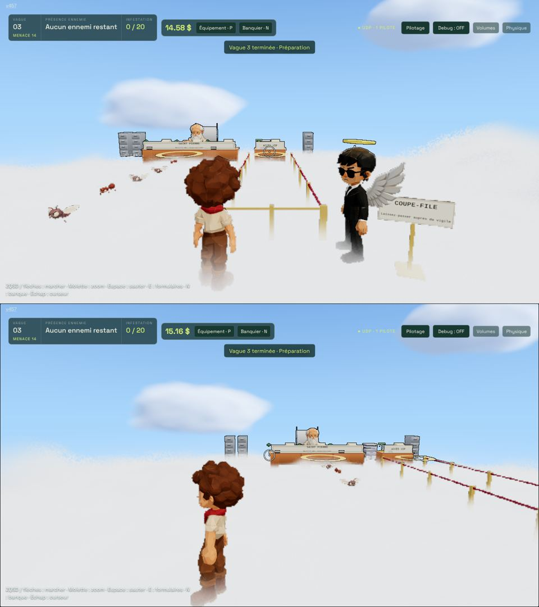

# Décor du purgatoire

Le purgatoire est une administration posée sur un nuage, en plein ciel bleu. Il garde
l’esprit du bureau : les meubles du **Cartoon Office Pack** (les mêmes que la carte
principale) y sont posés à taille humaine sur le nuage. Les règles de marche, la file
et le guichet ne changent pas ([file des purgatoires](purgatory-queue.md)) : le décor
n’ajoute aucun obstacle partagé.

Code : `src/purgatory-scene.ts` (scène, mobilier, panneaux, vigile) et
`src/purgatory-clouds.ts` (ciel, nuage-sol, nuages volumétriques). `client.js` crée
la scène avec `createPurgatoryScene`, l’anime avec `update()` et dessine la couche de
nuages avec `prerender()` avant chaque image du purgatoire.

## Le nuage-sol

- La salle (`PURGATORY_HALL`) reprend le rectangle de marche de `purgatory-queue.ts`
  (x de −10 à 10, z de 0 à 80 et plus), plus l’arrière du guichet. Le nuage y est
  **plat** (y = 0) : les âmes marchent dessus comme sur un sol.
- Au-delà, le dessus du nuage gonfle en bosses douces (`cloudHeight`, jusqu’à environ
  1,2 unité) jusqu’à son bord (`CLOUD_FLOOR`, ±16 en x, de −11 à 96 en z). Une
  marbrure blanc-bleu (bruit de valeur, couleurs par sommet) évite un aplat uniforme.
- Le bord est fait de boules aplaties (`cloudPuffs`) : un rebord dont le sommet dépasse
  un peu, un anneau plus bas, de petites boules à demi enfouies dans la marge et un
  ventre sous le nuage. Tout est déterministe (même décor pour tous) et dessiné en une
  seule instance, avec le rendu dessin animé commun.
- Le **mur invisible** reste la borne de marche existante ; les meubles alignés juste
  au-delà (x = ±11,5) montrent où elle se trouve. On ne peut pas tomber du nuage.

## Ciel et nuages volumétriques

- Le ciel est un dôme dessiné derrière tout (`createSkyDome`) : zénith bleu, horizon
  clair, brume pâle sous l’horizon, halo et disque du soleil dans la direction
  `SUN_DIRECTION`, partagée avec la lumière.
- Huit petits nuages (`SKY_CLOUDS`) flottent autour, au-dessus et en dessous du
  nuage-sol. Chacun est **calculé par lancer de rayons en WebGL2** dans sa boîte :
  densité en cumulus (dôme à base aplatie érodé par un bruit fractal), courte marche
  vers le soleil, absorption Beer-poudre, diffusion Henyey-Greenstein à deux lobes et
  liseré argenté. Ils dérivent lentement.
- Les nuages sont calculés à **demi-résolution** (`CLOUD_LAYER_SCALE`) dans une cible
  à part, avant l’image ; le dôme compose cette couche derrière la scène. Ils ne passent
  donc jamais devant le nuage-sol ni les meubles, ce qui est juste car aucun ne se
  trouve entre la caméra et le décor (`test-purgatory-scene.mjs` le vérifie).
- Sans WebGL (rendu logiciel de secours), ni dôme ni nuages : le fond est uni.
- Au super purgatoire, le ciel passe au crépuscule (`SKY_LOOK.super`), la brume suit.

### Coût mesuré

Mesures en rendu logiciel (Chromium SwiftShader, 1280 × 720, vue d’arrivée), qui
exagère le coût par pixel par rapport à une vraie carte graphique : ancien décor 7,3 à
8,0 images/s ; nouveau décor sans nuages 5,0 ; nuages en pleine résolution 3,7 ; nuages
en demi-résolution 4,3. Le coût sur carte graphique réelle reste à mesurer en partie.
Le passage à WebGPU est suivi à part.

## Mobilier et guichet

- `purgatoryProps()` liste chaque meuble du pack, placé à la main en unités de la
  scène puis ramené en mètres (`WALK_WORLDS.purgatory.sceneScale`). Aucun meuble
  bloquant ne se trouve dans la salle de marche ni ne coupe les cordons VIP.
- **Le guichet** : trois bureaux pour la file des insectes et un au guichet VIP, leur
  face tournée vers Saint Pierre (écran, clavier, lampe de son côté ; papiers, agrafeuse
  côté visiteurs). Leur bord avant reste derrière le bord de la salle (z < 0).
- **L’arrière**, derrière Saint Pierre : uniquement de l’équipement de bureau, sans
  surcharge (tableau blanc, trois classeurs, une photocopieuse).
- **Les bords** : plantes, classeurs, bibliothèques, distributeur, fontaine, coin
  d’attente (canapé, table basse, chaises visiteurs) et quelques feuilles froissées
  perdues sur le nuage (petites, on marche dessus).

## Signalétique

Les anciens textes flottants sont remplacés par des objets du monde, peints aux
couleurs des documents papier (`--paper`, `--ink`, police machine à écrire) :

- une plaque sur la façade du guichet : « SAINT PIERRE · Guichet des résurrections »,
  « SUPER SAINT-PIERRE · Direction des récidives » au super purgatoire ;
- une plaque « ACCÈS VIP » sur le bureau VIP (ouvert à toute âme qui paie) ;
- un pupitre « COUPE-FILE · Laissez-passer auprès du vigile » à côté de la barrière ;
- « PLACE AU GUICHET » peint au sol devant le cercle du guichet.

Les cercles du guichet changent toujours de teinte quand c’est son tour.

## Le vigile de la file VIP

Modèle Meshy « Guardian in Black » fourni par l’utilisateur (ange en costume noir,
lunettes noires, oreillette, ailes et auréole), squelette SmartRig de 48 os, sans
animation ([pipeline des assets](asset-pipeline.md#vigile-de-la-file-vip)).
`src/vip-guard-model.ts` le dessine à 1,95 m (une tête de plus que les âmes) et lui
donne une attente en boucle de 12 s : trois respirations (poitrine et épaules) et un
regard de chaque côté le long de la file. Saint Pierre garde provisoirement son
ancien modèle, en attendant le sien.

Le vigile s’utilise comme un poste d’engin ([règles d’interface](ui-guidelines.md)) :
à portée (`nearVipGuard`) et sans coupe-file, le vigile visé par le réticule (ou par le
curseur libéré avec Échap) est entouré du **bleu signal** (`PostHighlight`,
`SelectionOutline`, comme pour monter dans un appareil) ; un clic ouvre le coupe-file,
comme **E**. Une fois le coupe-file payé, ou hors de portée, il n’est plus entouré.
Le masque du contour est animé par le squelette du vigile (respiration, regards), et le
tracé ne couvre que son rectangle d’écran : sur l’écran plein du premier essai, le survol
faisait passer une partie de 120 à 72 images/s (trace Chrome, travail JavaScript inchangé,
carte graphique saturée) ; en rendu logiciel, la cadence au survol passe de 3,0 à 5,5
images/s (6,0 sans survol).

## Vérification

`scripts/test-purgatory-scene.mjs` : salle plate là où l’on marche, nuage plus large
que la salle, boules sous le sol de la salle, nuages du ciel à l’écart du nuage-sol et
dans la portée de la caméra, aucun meuble bloquant dans la salle ni sur les cordons,
bureaux du guichet, provenance et taille du vigile, boucle et amplitude de son attente,
construction de la scène sans document ni shader.
