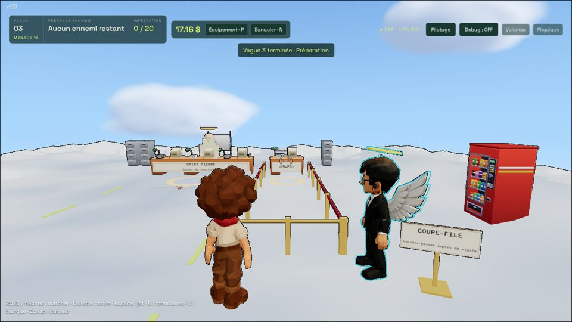

# Décor du purgatoire

Le purgatoire est une administration posée sur un nuage, en plein ciel bleu. Il garde
l’esprit du bureau : le guichet de Saint Pierre est fait des meubles du **Cartoon Office
Pack** (les mêmes que la carte principale), à taille humaine ; le long de la file, seuls
quelques meubles de salle d’attente. Les règles de marche, la file
et le guichet ne changent pas ([file des purgatoires](purgatory-queue.md)) : le décor
n’ajoute aucun obstacle partagé.

Code : `src/purgatory-scene.ts` (scène, mobilier, panneaux), `src/purgatory-clouds.ts`
(ciel, nuages du ciel), `src/purgatory-floor.ts` (nuage-sol volumétrique),
`src/saint-pierre-model.ts` et `src/vip-guard-model.ts` (personnages). `client.js` crée
la scène avec `createPurgatoryScene`, l’anime avec `update()`, dessine la couche des
nuages du ciel avec `prerender()` avant l’image, puis le nuage-sol avec `postrender()`
juste après.

## Le nuage-sol

Le sol est le **même nuage volumétrique** que ceux du ciel : on marche à moitié dedans.

- La salle (`PURGATORY_HALL`) reprend le rectangle de marche de `purgatory-queue.ts`
  (x de −10 à 10, z de 0 à 80 et plus), plus l’arrière du guichet. Les âmes marchent
  toujours à y = 0 ; la brume monte jusqu’aux genoux (`FLOOR_MIST.top`, 0,95 unité pour
  une âme de 2,46) et devient dense sous le sol (`FLOOR_MIST.dense`) : les jambes s’y
  perdent progressivement.
- À 2,5 unités au-delà de la salle (`FLOOR_MIST.margin`), le nuage se gonfle en
  bourrelets de 3 unités environ ; son bord (`CLOUD_FLOOR`, ±16 en x, de −11 à 96 en z)
  s’effiloche, et son ventre descend jusqu’à −7.
- Rendu : une passe d’écran après la scène (`createFloorCloud`), par lancer de rayons
  (bruit fractal animé, marche vers le soleil, Beer-poudre, Henyey-Greenstein). Chaque
  rayon s’arrête sur la surface opaque la plus proche, lue dans la profondeur
  logarithmique du rendu dessin animé (`ToonRenderer.depthTexture`) : une jambe dans la
  brume n’est couverte que par le nuage devant elle. La passe est calculée à **40 %** de
  la résolution (`FLOOR_LAYER_SCALE`) en gardant la profondeur la plus lointaine de
  chaque pixel (pas de halo couleur ciel autour des silhouettes), puis composée sur
  l’image. Au-dessus de la surface du nuage, un rayon saute directement jusqu’à elle
  (saut d’espace vide) avant de marcher à pas fins (64 pas au plus) : sans ce saut, les
  pas s’épuisaient vers 19 unités et le nuage n’était dessiné qu’autour de la caméra
  (il semblait suivre le joueur, les meubles lointains flottaient au-dessus du vide).
  Un rayon qui atteint la couche dense dans l’étendue du nuage sans s’être rempli est
  complété par la couleur de la surface : aucun trou vers le ciel.
- Ce qui doit rester lisible flotte au-dessus de la brume : cercles du guichet et
  marquage « PLACE AU GUICHET » (à la hauteur de la brume), insectes de la file
  (`hover`, aux trois quarts de cette hauteur), plaques posées sur les bureaux.
- Sans WebGL (rendu logiciel de secours), l’ancien nuage dessin animé reste : dessus
  plat sur la salle et bosselé autour (`cloudHeight`), boules du bord (`cloudPuffs`).
- Le **mur invisible** reste la borne de marche existante ; les meubles de salle
  d’attente juste au-delà (x = ±11,5) montrent où elle se trouve. On ne peut pas tomber
  du nuage.

## Ciel et nuages volumétriques

- Le ciel est un dôme dessiné derrière tout (`createSkyDome`) : zénith bleu, horizon
  clair, brume pâle sous l’horizon, halo et disque du soleil dans la direction
  `SUN_DIRECTION`, partagée avec la lumière.
- Huit petits nuages (`SKY_CLOUDS`) flottent autour, au-dessus et en dessous du
  nuage-sol. Chacun est **calculé par lancer de rayons en WebGL2** dans sa boîte :
  densité en cumulus (dôme à base aplatie érodé par un bruit fractal), courte marche
  vers le soleil, absorption Beer-poudre, diffusion Henyey-Greenstein à deux lobes et
  liseré argenté. Ils dérivent lentement.
- Les nuages sont calculés à **demi-résolution** (`CLOUD_LAYER_SCALE`) dans une cible
  à part, avant l’image ; le dôme compose cette couche derrière la scène. Ils ne passent
  donc jamais devant le nuage-sol ni les meubles, ce qui est juste car aucun ne se
  trouve entre la caméra et le décor (`test-purgatory-scene.mjs` le vérifie).
- Sans WebGL (rendu logiciel de secours), ni dôme ni nuages : le fond est uni.
- Au super purgatoire, le ciel passe au crépuscule (`SKY_LOOK.super`), la brume suit.

### Coût mesuré

Mesures en rendu logiciel (Chromium SwiftShader, 1280 × 720, vue d’arrivée), qui
exagère le coût par pixel par rapport à une vraie carte graphique : ancien décor 7,3 à
8,0 images/s ; nouveau décor sans nuages 5,0 ; nuages en pleine résolution 3,7 ; nuages
en demi-résolution 4,3. Nuage-sol volumétrique : 4,3 à 5,3 avec le nuage dessin animé,
2,3 avec le nuage-sol à demi-résolution (56 pas, deux échantillons de lumière), 3,7 à
4,0 avec 40 % de résolution, 40 pas et un échantillon ; 4,7 avec le saut d’espace vide
(nuage dessiné jusqu’au bout de la salle). Le coût sur
carte graphique réelle reste à mesurer en partie.
Le passage à WebGPU est suivi à part.

## Mobilier et guichet

- `purgatoryProps()` liste chaque meuble du pack, placé à la main en unités de la
  scène puis ramené en mètres (`WALK_WORLDS.purgatory.sceneScale`). Aucun meuble
  bloquant ne se trouve dans la salle de marche ni ne coupe les cordons VIP.
- **Le guichet** : trois bureaux pour la file des insectes et un au guichet VIP, leur
  face tournée vers Saint Pierre (écran, clavier, lampe de son côté ; papiers, agrafeuse
  côté visiteurs). Leur bord avant reste derrière le bord de la salle (z < 0).
- **L’arrière**, derrière Saint Pierre : uniquement de l’équipement de bureau, sans
  surcharge (tableau blanc, trois classeurs, une photocopieuse).
- **Le long de la file**, rien que ce qui évoque une salle d’attente : deux coins salon
  (canapé, table basse et sa pile de magazines), deux fontaines à eau, deux rangées de
  chaises visiteurs. Aucune fourniture de bureau hors du guichet.

## Signalétique

Les anciens textes flottants sont remplacés par des objets du monde, peints aux
couleurs des documents papier (`--paper`, `--ink`, police machine à écrire) :

- une plaque posée au bord des bureaux du guichet, au-dessus de la brume : « SAINT
  PIERRE · Guichet des résurrections », « SUPER SAINT-PIERRE · Direction des récidives »
  au super purgatoire ;
- une plaque « ACCÈS VIP » sur le bureau VIP (ouvert à toute âme qui paie) ;
- un pupitre « COUPE-FILE · Laissez-passer auprès du vigile » à côté de la barrière ;
- « PLACE AU GUICHET » peint au sol devant le cercle du guichet.

Les cercles du guichet changent toujours de teinte quand c’est son tour.

## Saint Pierre

Modèle Meshy « The Keeper of Wisdom » fourni par l’utilisateur (vieillard à longue barbe
blanche, robe, clé à la ceinture), squelette SmartRig de 39 os, sans animation
([pipeline des assets](asset-pipeline.md#saint-pierre)). `src/saint-pierre-model.ts` le
dessine à 1,85 m (×1,4 au super purgatoire) et l’anime en procédural (`SaintPierre`) :

- une respiration lente (4 s) ;
- la tête tournée vers l’âme ou l’insecte qu’il sert (`servedAt`) ;
- quand il change de guichet, des pas qui suivent la distance parcourue (jambes, bras
  en balancier, léger rebond) ;
- pendant qu’il sert un insecte (`stamping`), le bras droit lève le tampon et l’abat,
  environ 1,4 fois par seconde ; le bruit du tampon final reste celui du guichet.

## Le vigile de la file VIP

Modèle Meshy « Guardian in Black » fourni par l’utilisateur (ange en costume noir,
lunettes noires, oreillette, ailes et auréole), squelette SmartRig de 48 os, sans
animation ([pipeline des assets](asset-pipeline.md#vigile-de-la-file-vip)).
`src/vip-guard-model.ts` le dessine à 1,95 m (une tête de plus que les âmes) et lui
donne une attente en boucle de 12 s : trois respirations (poitrine et épaules) et un
regard de chaque côté le long de la file.

Le vigile s’utilise comme un poste d’engin ([règles d’interface](ui-guidelines.md)) :
à portée (`nearVipGuard`) et sans coupe-file, le vigile visé par le réticule (ou par le
curseur libéré avec Échap) est entouré du **bleu signal** (`PostHighlight`,
`SelectionOutline`, comme pour monter dans un appareil) ; un clic ouvre le coupe-file,
comme **E**. Une fois le coupe-file payé, ou hors de portée, il n’est plus entouré.
Le masque du contour est animé par le squelette du vigile (respiration, regards), et le
tracé ne couvre que son rectangle d’écran : sur l’écran plein du premier essai, le survol
faisait passer une partie de 120 à 72 images/s (trace Chrome, travail JavaScript inchangé,
carte graphique saturée) ; en rendu logiciel, la cadence au survol passe de 3,0 à 5,5
images/s (6,0 sans survol).

## Vérification

`scripts/test-purgatory-scene.mjs` : salle plate là où l’on marche, nuage plus large
que la salle, boules sous le sol de la salle, nuages du ciel à l’écart du nuage-sol et
dans la portée de la caméra, brume jusqu’aux genoux, aucun meuble bloquant dans la
salle ni sur les cordons, rien que la salle d’attente le long de la file, bureaux du
guichet, provenance et taille du vigile et de Saint Pierre, pas, tampon et regard de
Saint Pierre, construction de la scène sans document ni shader.
