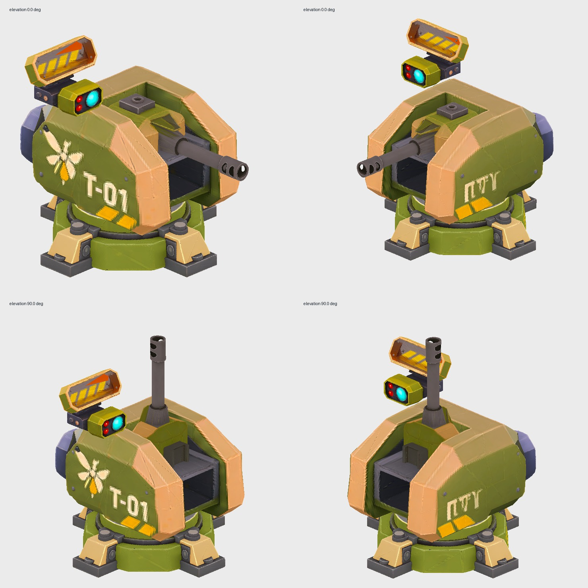

# Tourelle automatique T-01 — quatre modules Meshy

La tourelle automatique du **G1 Castor** est un assemblage de quatre modèles Meshy indépendants. Ces exports sont des maillages et textures véritables, et non une redécoupe de l'ancien GLB monobloc. La tourelle conserve un **canon unique**, une optique visible et la direction artistique low-poly olive/sable/jaune/noir du G1.

## Origines contrôlées

| Pièce         | Tâche Meshy                            | Triangles | SHA-256 original                                                   |
| ------------- | -------------------------------------- | --------: | ------------------------------------------------------------------ |
| Socle fixe    | `01a1b589-f91a-74d7-9cfd-af1e09fc7fcf` |     3 149 | `cadf161689f2adb53caa3ac8c8968d5393a6f53fface5cc9b6cc07dfe889c695` |
| Tête rotative | `01a1b58b-8015-7247-b17b-351c9946a143` |     4 380 | `105bef2d800728dd5e208a404a95f4e45b8a66b428c46b99f91efc90e6779472` |
| Bloc canon    | `01a1b58b-8f11-7588-92a6-80bdb540bbe5` |     3 684 | `b29849fbb1b7bb3e9d837462977d6934808e59535f13340e452684cd3eeaa743` |
| Capteur/radar | `01a1b58b-9c0b-74a9-bb5c-269a36d9169c` |     2 413 | `5f5882e848d834f8b3e9bdba71ab63f0c67e74b632909f433021c38908f1467c` |

Les exportations GLB Meshy portent des noms à horodatage, qui **ne suivent pas l'ordre de génération**. Correspondance vérifiée visuellement et contre les liens d'export des tâches : socle `...102715.glb`, tête `...103356.glb`, canon `...103334.glb`, capteur `...103241.glb`.

Les quatre originaux comptent **13 626 triangles** au total et chacun contient un maillage, un jeu d'UV et une texture PBR 2 048 × 2 048 pixels. Les atlas intégrés au jeu reprennent ces mêmes couleurs, avec un **rééchantillonnage WebP 1 024 × 1 024** pour réduire la taille de livraison ; ce n'est pas une conservation pixel à pixel. Les coordonnées UV et les faces sont conservées. Aucune réduction de triangles supplémentaire n'a été appliquée aux exports : le faible budget initial, fourni par Meshy Smart Topology, est déjà compatible avec une tourelle miniature. **Pas de gain FPS revendiqué sans comparaison WebGL.**

## Reproduction de l'import

Les originaux doivent être conservés **hors du dépôt** (leur SHA est contrôlé par le script). Installer les dépendances Python employées par les importeurs Meshy existants (`trimesh`, `numpy`, `Pillow`). Placez les GLB renommés sous `assets/originals/t01/` : `socle.glb`, `tete.glb`, `canon.glb`, `capteur.glb`. Puis :

```sh
python3 scripts/import-meshy-t01.py \
  --sources assets/originals/t01 --output src --texture-size 1024
```

Cette commande ne modifie pas les GLB d'origine. Elle génère `src/meshy-t01-*-data.js` avec les atlas, UV, positions et indices encodés, selon le même modèle offline que les véhicules Meshy du jeu. Le runtime n'a pas besoin de décodeur GLB/CDN.

Pour explorer une réduction **supplémentaire** avec l'outillage gratuit, voir [le pipeline d'assets](asset-pipeline.md) et tester les variantes sur des **copies de chaque pièce indépendante** avant de renouveler les SHA approuvés. Éviter de réduire sans test visuel les embases, logement de canon et jonction des pivots. Il faut comparer les originaux et les dérivés dans un navigateur ; l'environnement ayant créé cette PR ne dispose pas de Docker pour exécuter l'outil localement sur ces quatre GLB.

## Articulation et intégration

Dans `src/sentry-model.js`, le socle reste immobile. La tête et son radar suivent un groupe _yaw_ (360°) ; le canon possède un groupe _pitch_ distinct (−10° à +90°). Chaque fichier Meshy avait son propre axe avant : l'assemblage aligne la tête (+X source), le canon (−X source) et le radar (+Z source) vers −Z du jeu par des transformations **propres à chaque module**. Les échelles et pivots sont fixes et documentés dans le code. Le radar est monté latéralement pour éviter le passage du canon à +90° ; sa position doit être contrôlée en WebGL et peut être ajustée sans regénérer le modèle.

Le code partage les géométries et matériaux des modèles entre toutes les tourelles d'une salle, mais chaque tourelle possède ses pivots d'animation propres. Leur orientation visuelle suit les cibles que le serveur a déjà choisies. Les règles serveur de tirs, dégâts, portée, achat, munitions et recharge ne changent pas.

**Effets de tir (version 240, [issue #108](https://github.com/simonjamain/i-am-a-moucheron/issues/108)).** Chaque tir serveur publie un effet `sentry-shot` portant l'identifiant de la tourelle. Tous les clients orientent alors le canon vers la cible, tirent un traceur depuis la vraie bouche (`bouche-canon` du modèle) avec un éclair de bouche, et appliquent un recul de 3 mm qui s'amortit. Les tirs restaient auparavant invisibles : l'effet n'était pas consommé côté client.

**Vérifications automatisées :** tests de SHA, comptage des triangles, présence des UV/images, hiérarchie et écart des pivots à +90°, absence de duplication des ressources et régressions réseau. **Reste à valider manuellement :** qualité des textures en WebGL sur les deux côtés, dégagement du radar pendant toutes les élévations, effet de tir au bout du canon, échelle avec les ennemis, confort de suivi et FPS avec 12 tourelles.

## Expérimentation CI de l'optimiseur sur la T-01

Le job GitHub Actions `Asset tool Docker and UV tests` reconstruit temporairement
des GLB à partir des **positions, indices et UV réellement issus des quatre GLB
Meshy** déjà intégrés dans `src/meshy-t01-*-data.js`. Il lance le conteneur
glTF Transform + meshoptimizer avec `--ratio 0.75 --error 0.005`, puis
compare et valide chaque variante. Il publie
l'artifact `t01-meshy-geometry-optimization` avec les nombres mesurés.

Cette expérience porte sur les **maillages Meshy reconditionnés**, pas sur les
fichiers GLB source exacts : les originaux ne sont pas versionnés dans Git, et la
texture du GLB de test est un PNG de 1 pixel pour isoler le contrôle
géométrie/UV. Les **vraies couleurs et textures WebP du jeu ne sont pas modifiées**.
Les variantes d'optimisation CI sont exploratoires et ne sont **pas** utilisées
dans le runtime automatiquement, même en cas de réduction mesurée : il faut
valider le rendu visuel des articulations avant de substituer un maillage.

## Mesures réelles de simplification (GitHub Actions)

Le job **Asset tool Docker and UV tests** du commit
`9bea73f2ab15e9df19cd6912d45c639b2b3ebb09` a réellement lancé
glTF Transform / meshoptimizer sur les **géométries et UV des quatre
modules importés**, reconstruits en GLB de test. Paramètres : ratio
`0.75`, erreur `0.005` ; aucun fichier du jeu n'a été remplacé.

| Module    | Triangles source | Variante de test |     Gain |
| --------- | ---------------: | ---------------: | -------: |
| Socle     |            3 149 |            2 361 |     25 % |
| Tête      |            4 380 |            3 284 |     25 % |
| Canon     |            3 684 |            2 762 |     25 % |
| Capteur   |            2 413 |            1 809 |     25 % |
| **Total** |       **13 626** |       **10 216** | **25 %** |

Les quatre sorties ont passé `validate` (attributs, indices, UV,
nœuds, texture de test), mais **chacun des GLB optimisés était plus gros
que son GLB de test initial**. L'essai ne permet pas d'affirmer un gain
de téléchargement ou de FPS. Aucune variante simplifiée n'est activée
dans le runtime : **il reste à vérifier les petits détails et les
articulations en WebGL**, avec les véritables textures, avant substitution.

## Prévisualisation hors navigateur



_Aperçu de validation CPU, deux points de vue et deux élévations,
avec les vrais UV/textures Meshy ; pas une capture du moteur Three.js.
Le support radar est décalé latéralement pour laisser passer le canon._
